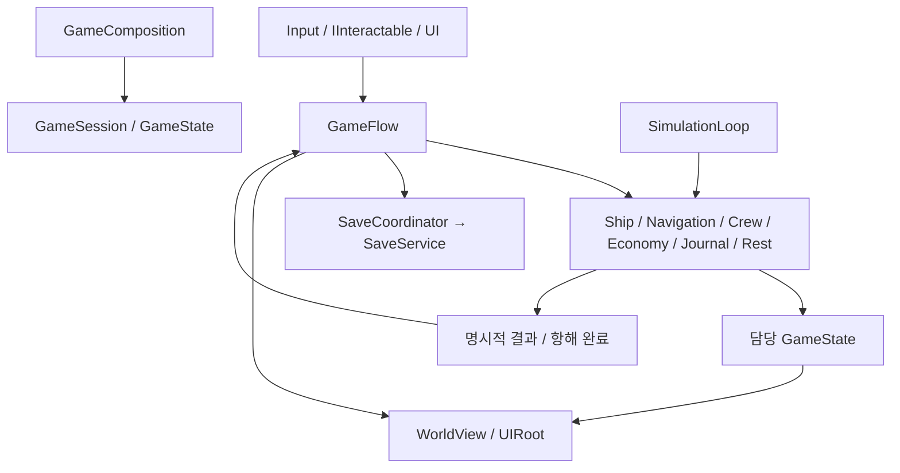

# 1~7단계 구조 감사 및 재구성 설계안

작성: 2026-10-20 (Asia/Seoul). 상태: **R0 정적 감사 결과 + R1 승인 전 제안**. 아래 새 파일명·타입명·Scene/Prefab 구성은 구현안이며 확정 규범이나 구현 완료 기록이 아니다. 이 문서 작성으로 코드·자산 변경, 테스트, 브랜치, 커밋·푸시가 승인되지는 않는다.

최신 갱신 — 2026-10-20: 사용자가 전체 설계를 향후 기준안으로 사용하되 **새 브랜치와 S1 구현만 승인**했다. 실제 S1 구현과 검증 결과는13절에 보존한다. 최신 UI Frame 선행 요청에 따라6·8·9·10절은 개정안이며14절이 현재 승인 요청이다. 12절은 최초 승인 요청의 과거 기록이다. S2 이후·저장 변환·기능 테스트·커밋·푸시·병합은 승인되지 않았다.

최신 실행 승인 — 2026-10-20: 사용자가 “미니게임은 우선 무시할 것 제작 범위 승인”이라고 지시했다. **F20 Host와 내부 UI 모두 이번 U0에서 제외**하며 U0 수용 차단 항목이 아니다. 나머지 Frame 제작 범위는 승인되었다. 실제 결과는15절, 이전14절의 미니게임 선행 확정/승인 대기 문구는 당시 제안 이력이다. 기능 테스트·S2·Git 작업 승인은 포함하지 않는다.

## 1. 결론과 조사 범위

현재 구현은 공통 상태 클래스와 일부 Prefab을 공유하지만, 서로 다른 Scene 구성과 슬롯을 수동 선택하는 기능 프로토타입 집합이다. 최종 공간 흐름, 편집 가능한 UI, 인물·물품의 단일 원본, 규칙과 표현의 독립성이 부족하다. PortPrototype을 이름만 바꾸거나 패널만 교체하는 것으로는 해결되지 않는다.

제안은 **공통 실행 Scene 1개 + 공통 GameRoot Prefab + 공간별 콘텐츠 Prefab + 플레이 단위 상태 + 화면을 참조하지 않는 규칙 서비스**다. 기존 규칙의 유효한 알고리즘과 자산은 재사용하되, Scene에 묶인 상태·UI 역참조·콘텐츠별 하드코딩 경계는 다시 설계한다. 새 패키지, 전역 서비스 로케이터, 범용 ECS/DI 프레임워크, 모든 미래 시스템의 빈 클래스는 도입하지 않는다.

### 근거와 한계

- 기준: [AGENTS](../AGENTS.md), [Rules](Rules.md), [ArchitectureStandards](ArchitectureStandards.md), [GameDesign](GameDesign.md), [RoadMap](RoadMap.md), [Architecture](Architecture.md), [State](State.md), [원본 기획서](References/최종기획서.md). 원본 지시의 실행 권한은 현재 요청과 Rules로 제한했다.
- Git: `codex/journal-autopilot-sleep`, HEAD `0e9c96d7b41f836ba0df664c7d0f4805ff35541f`. 기존 지침 반영·정합성 정비의 미커밋 문서를 보존했다. 7단계 사용자 직접 수정·테스트 사실은 사용자 확인, 커밋 존재는 Git 확인이다. 개별 테스트 시나리오·결과는 미확인이다.
- 실제 조사: Assets/Scripts의 게임 스크립트 33개, CaptainsCabin/CrewPrototype/PortPrototype의 저장된 YAML·참조, Player/Crew/JournalDesk/Bed Prefab, 함선·선원·경제·항해 정의 자산, SaveData/SaveService, Packages와 EditorBuildSettings. SampleScene은 실행 등록 상태를 확인했다.
- 이미지 직접 열람: D01~D12, E01~E04·E07~E11, G01~G03. D는 구획·연결, E는 예시, G는 화풍 기준으로 구분했다. 전투·조선소는 D06/D07과 본문을 통해 후속 연결만 설계했으며 E05/E06은 이번 직접 열람 범위에 포함하지 않는다.
- 기존 Unity CLI 실행 권한 문제 후 읽기 전용 도움말·상태 조회를 수행했다. 대상 프로젝트의 Pipeline 인스턴스가 없어 현재 Editor 메모리 Hierarchy·미저장 상태·렌더링은 확인하지 못했다. Editor를 새로 실행하거나 Scene을 열지 않았다. 아래 Hierarchy는 **디스크 직렬화 상태**다. stripped Prefab 객체는 원본 Prefab과 함께 대조했으며 간이 YAML 조사를 Unity의 완전한 참조 검증으로 주장하지 않는다.
- 컴파일·빌드·Play/Edit Mode 기능 테스트·저장 데이터 실행/변환은 미실행이다. 코드 독해로 확인한 경로와 실제 동작 통과를 구분한다.
- 원본 md의 현재 CRLF 바이트 해시와 GameDesign의 원본 LF 해시는 다르지만 LF 정규화 SHA-256은 `e958bd5e0c660cbc0f148165b2905653e076bcf9793016b64662f213b0edcfd0`로 일치한다. 내용 변경 근거가 아니며 이번에 줄바꿈·원본을 수정하지 않는다.

주요 코드 근거: [GameSession](../Assets/Scripts/Game/GameSession.cs), [SaveService](../Assets/Scripts/Save/SaveService.cs), [ShipLayout](../Assets/Scripts/Ship/ShipLayout.cs), [NavigationSession](../Assets/Scripts/Navigation/NavigationSession.cs), [CrewSimulation](../Assets/Scripts/Crew/CrewSimulation.cs), [EconomySession](../Assets/Scripts/Economy/EconomySession.cs), [PortPanel](../Assets/Scripts/UI/PortPanel.cs), [JournalPanel](../Assets/Scripts/UI/JournalPanel.cs), [JournalMap](../Assets/Scripts/UI/JournalMap.cs), [PlayerInteraction](../Assets/Scripts/Player/PlayerInteraction.cs), [PlayerSleep](../Assets/Scripts/Player/PlayerSleep.cs), [빌드 Scene 등록](../ProjectSettings/EditorBuildSettings.asset).

## 2. R0 — 현존 Scene·Prefab·데이터

### 실행과 객체 구성

| 대상 | 확인한 실제 구성 | 구조상 의미 |
|---|---|---|
| EditorBuildSettings | 활성 Scene은 SampleScene 하나 | 1~7단계의 공통 게임 시작 경로가 실행 설정에 연결되지 않음. 배포 작업과 구별해 이후 개발 실행 진입점 정비 필요 |
| CaptainsCabin | 저장된 GameObject 96개, Player/JournalDesk Prefab 인스턴스 각 1개. GameSession, Ship 아래 ShipLayout/NavigationSession/CrewSimulation, CabinUI, PrototypePort, Camera, EventSystem | 경제·일지 도메인·취침 없는 이전 구성. 슬롯/공간 `cabin-session`/`captains-cabin` |
| CrewPrototype | GameObject 99개, 같은 두 Prefab 인스턴스. 별도 Ship/CabinUI/PrototypePort, CrewStatus·CrewResetButton | 독립 구성. `crew-prototype`, PrototypeShip/PrototypeCrew, 재준비 허용 플래그 |
| PortPrototype | GameObject 117개, 같은 두 Prefab 인스턴스. GameSession에 EconomySession/JournalSession/PlayerSleep, Ship에 함선·항해·선원, CabinUI에 JournalPanel/SessionPanel/PortPanel | 가장 많은 기능이 있으나 공통 실행 기반을 Prefab으로 공유하지 않음. `port-prototype`, StarterShip/PortCrew/PrototypeEconomy |
| 공간 | Ship/Deck1·Deck2/Geometry·Facilities, 계단·방향타·승하선 지점. PrototypePort에 부두·경계·승선 및 PortPrototype의 상인/대행인/주점 창구 | 실제 항구별 구역/포털/주점 내부·게시판 없음. 같은 항구 표현을 ID만 바꿔 사용 |
| UI | CabinUI 아래 일지·정지메뉴·날짜·층·항해상태. CanvasScaler 1600×900, match .5 | 해상도 대응 기반은 있으나 상인/고용 기본 트리는 저장된 Scene에 없음. 별도 화면 Prefab·Item Prefab도 없음 |
| Prefab | Player(Head/Body/Hand·Dynamic 몸체·이동/상호작용), Crew(Head/Body·Dynamic 몸체·CrewView), JournalDesk, Bed | 재사용 출발점. 월드 층·계단·항구·창구·UI의 재사용 단위는 없음. Crew의 Hand 표현 확장은 미술 단계와 연결 |

씬별 서비스가 별도 **구현 코드**를 모두 복제한 것은 아니다. 같은 스크립트와 DTO를 공유한다. 문제는 Composition·공간·UI 배치와 설정을 각각 복제하고 서로 다른 기능 집합·공간/슬롯 ID에 의존한다는 것이다. 현재 코드는 다른 개발 씬 동시 실행을 통합 방식으로 설계하지 않았다.

### 상태·정의·의존성

| 경계 | 실제 상태 | 문제/재사용 판단 |
|---|---|---|
| GameSession | SaveData·파일 경로·시간·정지·초기화·입항/일지/취침/선원 순서·플레이어 위치·종료·개발 초기화 소유 | 시간 경계·오류 정지·조율 순서는 보존 후보. 저장 형식과 Scene 구성, 개발 도구가 결합되어 책임 재설계 필요 |
| ShipLayout | 배치 검사·BFS·층 경로·수리·상태와 시설 생성·색·층 표시·플레이어 이동·층 UI를 함께 소유 | 논리 지도/시설 규칙과 표현/공간 전환 분리. BFS·Cell 환산·접근 검사 재사용 후보 |
| NavigationSession | 해상 상태·입항 교차·조타 키 입력·HUD Text·승하선 Transform·공간 활성화·일지/선원 참조 | 항해·입력·공간·표현 책임 결합. `statusLabel` 누락이 항해 초기화 실패 조건인 점도 분리 필요 |
| CrewSimulation | 생활·자격·선점·수리·경로·steering·물리 조회·뷰 생성·HUD·개발 리셋·플레이어 침대 선점 | 역할 경계 재설계. Nav+Context steering, 긴 재탐색 주기, 밀림/작업 복귀·화면 밖 이동 규칙 보존 |
| EconomySession | 거래/계약 규칙 외에 PortPanel 열기·닫기·정지·출항 호출·전체 세션 저장 | Economy→Panel→Economy 및 Economy↔Navigation/GameSession 순환. 행위 결과와 화면 전환/저장은 조율자로 이동 |
| JournalSession/PlayerSleep | 기록·계획·취침 상태는 분리되어 있으나 GameSession/Navigation/Crew/Ship/물리/저장에 직접 의존 | 경로 공백·이월·기상 경계 알고리즘 보존. 도메인 규칙과 진행 조율/물리 접근 분리 |
| 인물 | CrewRoster.members와 만료 계약의 formerCrew로 인물 원본 위치가 이동. 후보는 EconomySettings의 CrewState 복사본 | 활동·계약·콘텐츠 목록에 인물 수명 종속. 계약이 현재 후보 목록에 있는지까지 로드 검증해 후보 제거가 기존 계약 로드를 막을 수 있음 |
| 물품 | EconomyState.cargo 정수 1개, 항구 stock 정수, CrewRoster.food/repairTools 별도 | 제품 ID·소비 용도·거래·약탈·소유자의 확장 경계 부족. 규칙을 유지하며 재고 원본 통합 필요 |
| 공간/좌표 | SaveData.spaceId가 씬별 상수, playerX/Y는 Unity 좌표, 선원은 Cell, 항해는 별도 세계 좌표. aboard와 activeFloor로 지역 판단 | 선내/해상 분리는 적합. 항구 지역 ID/포털/선박 인스턴스가 없어 구역별 저장 및 다함선 확장에 부적합 |
| 정의 | Ship/Facility/Navigation 정의, CrewSettings에 초기 인물·밸런스·표현·helm 좌표, EconomySettings에 상품1개·후보·가격·급여·초기금 | SO/런타임 복사 분리는 재사용. 시작 시나리오와 밸런스/콘텐츠/표현 연결을 분리해야 함 |

## 3. R0 — 기획 대비 차이와 처리

| ID/단계 | 기획·도안 요구 | 현 구현/차이 | 분류·대상·위험 |
|---|---|---|---|
| S1 이동/상호작용 | 직접 이동·차폐·책상 진입, 새 대상 확장 | 물리 이동·책상은 존재. PlayerInteraction이 6종 GetComponent 분기와 JournalPanel의 안내 표시를 공용 진입으로 사용 | 이동 모터 재사용, IInteractable와 독립 Prompt/UI 요청 경계로 재설계. PlayerInteraction·각 상호작용·Player Prefab. 입력 차단 회귀 |
| S2 시간/정지/저장 | A02/A27, 단일 시간·정지, 안전한 복원 | Pause 핸들·원자 저장 존재. SaveData가 실시간 상태이자 파일 DTO, Update와 FixedUpdate·항해 Update의 시간/입력 순서가 분산 | Pause 재사용, GameSession·SaveCoordinator·SimulationLoop 분리. 저장 경계 회귀 위험 높음 |
| S3 함선 | D02, 층 데이터·시설 점유·다른 층 진행 | 2층·침대·Cell 존재. 2층 자체는 허용된 최소 콘텐츠. 공간은 Scene 내장, floor.entry 하나로 계단 경로를 표현 | ShipModel/ShipView/연결점 데이터로 재설계. 여러 계단을 floor 인접 여부 하나로 처리하지 않음. 기존 시설/층 ID 보존 |
| S4 항해/항구 | A04, D09~D12, 구역·통로·포털·승하선 | 해상 좌표·재입항·선분 교차 존재. 항구는 작은 단일 공간, 구역/포털 없음 | 입항 알고리즘 재사용, WorldArea/AreaLink/Flow 신설. 항구별 상태는 공유 뷰와 분리. 위치 변환·막힌 스폰 위험 |
| S5 선원 | A03/A07/A08, 생활·선점·화면 밖 진행·이동 보완 | 대표 기능 코드 존재. 업무/경로/steering/뷰/HUD/자원/플레이어 침대가 CrewSimulation에 결합 | CrewBrain·CrewMovement·ReservationService·뷰 생성 분리. 새 직업은 새 규칙 추가로 연결. 선점/저빈도 판단/밀림 회귀 |
| S6 경제/계약 | D04/D05, 판매 우측 1/3 요청 구역, 게시판 현재/과거 목록 | N회 선불·후불·정산 규칙 존재. PortPanel.Awake에서 900×660 화면 전체 생성. 문자열에 최근 계약 일부만 표시, 첫 채무만 지급 | 거래·고용·게시판·정산 화면 재제작. 대표 기존 계약 규칙 유지. 조건별 후보·채무 조회를 UI 목록으로 제공. 도메인·화면 순환 제거 |
| S7 일지/취침 | D03, 기록목록·지도·우측 이미지/설명, 펜·메모·레이어·이월 | 기본 3구획은 Scene에 저장되어 있음. 우측은 Image 영역 대신 텍스트, 목록은 MakeButton으로 런타임 생성. 고정 픽셀 배치 중심 | 기본 구획 재사용하여 Prefab화·이미지 슬롯·Layout 정리. HistoryItem Prefab 제작. 지도 메시/이월 규칙 재사용, 전체 UI 런타임 생성으로 오판하지 않음 |
| HUD | D01, 금화 좌상/퀘스트 좌중/항해일자 중앙/일자 우상·모바일 영역 | 시계·개발 항해/선원 문자열은 있으나 D01 전체 구획 없음 | GameHud 재제작. 미구현 퀘스트는 빈 영역, 모바일은 영역·행동 경계만. 디버그 문자열은 제품 HUD와 분리 |
| 정의/상태 | GameDesign14, 동일 인물·재고 ID 및 확장 | 상품·후보·층/helm 위치와 밸런스의 결합, 인물 수명 분산 | 실제 필요한 정의·상태 경계부터 교체. 모든 미래 능력·퀘스트·이벤트 구현은 제외 |
| 저장 | GameDesign13 및 체크포인트 보완 | v1~v8·.tmp/.bak·1MB 제한·중복 항해 방지 존재. Scene/설정 ID 엄격 일치 필요 | 파일 보호·중복 방지는 재사용. Legacy 어댑터·새 저장 경로/버전 필요. 8단계 사건 스냅샷은 아직 미구현으로 유지 |

`JournalPanel.BuildLayout`은 `Application.isPlaying`을 차단하는 **Editor 제작 함수**다. 기본 일지를 런타임 생성한다고 분류하지 않는다. 다만 제작 코드가 런타임 Controller에 섞여 있고 RefreshHistory는 코드로 버튼 트리를 생성하므로 전자는 Editor 전용 위치로 격리하거나 제작 종료 후 제거하고 후자는 Item Prefab으로 교체한다. Bed/Crew의 월드 Prefab 런타임 생성과 JournalMap의 메시 생성은 금지 대상이 아니다.

### 기존 문서와 신규 표준의 충돌

- Architecture의 개발 씬 단독 실행·PortPrototype 사본 방식은 당시 사실이다. 새 공통 실행/통합 게이트를 충족하는 설계 근거가 될 수 없다.
- Architecture의 '최종 UI는 10단계'는 미술·콘텐츠 확장에 한정한다. 화면 구획·항구 진입·게시판 구조는 S6에서 필요하다.
- 객체 계층·통합을 나중으로 유보한 과거 완료 기록은 기능 통과로 보존하며 새 골격 완료로 인정하지 않는다.
- Rules의 기존 도메인 재사용 원칙은 적합성을 검토하는 원칙이다. 최신 사용자 요청에 따라 부적합한 상태/책임 구조는 재설계·재구현한다. 기존 코드를 보존하기 위해 새 기준을 낮추지 않는다.
- GameDesign의 큰 단계와 RoadMap 실행 번호 차이는 기존 대응표로 해소되어 있다. 1~7은 RoadMap 번호다. 새로 확인한 규범 간 직접 모순은 없으며 현재 구현의 표준 미달과 구분한다.

### 현재 게이트 판정

| 게이트 | 정적 판단 | 근거/제한 |
|---|---|---|
| A 기획 | 통합 기반으로는 미통과 | 항구 구역·게시판·거래/고용 UI·HUD 누락/축소 |
| B 편집 구조 | 미통과 | PortPanel 전체 런타임 생성, 목록 Item Prefab 부재, 공간/공통 구성 복제 |
| C 책임·확장 | 미통과 | UI 역참조·혼합 책임·단일 cargo·인물 수명/계약 결합 |
| D 통합 | 미통과 | 서로 다른 개발 씬과 슬롯, 공통 시작 구성 없음. PortPrototype 내 여러 기능 연결은 부분 근거 |
| E 저장 | 새 구성에 대해 미확인 | 기존 안전 장치는 확인. 실제 저장 복원·전환·동작 검증 미실행 |
| F 검증 구분 | 이 보고에서 구분 | 과거 컴파일/사용자 테스트를 새 실행 결과로 사용하지 않음. 현재 컴파일/기능 미확인 |

## 4. R1 — 공통 실행 Scene과 공간 계약

### 대안 비교와 권고

| 대안 | 장점 | 비용/판단 |
|---|---|---|
| Game.unity + GameRoot/공간 Prefab | 세션 수명·시작/복원 단순, 테스트도 동일 Prefab 사용, 2D 소규모 구역 편집 가능 | 콘텐츠 규모 증가 시 로딩 정책 확장 필요. 현재 권고 |
| Bootstrap + Additive 공간 Scene | 큰 구역의 독립 로딩·공동 편집에 유리 | 교차 Scene 참조·활성 Scene·카메라/EventSystem 중복·언로드 경계 증가. 현재 필요 근거 부족 |
| 기존 3개 씬을 씬별 최종 구성으로 유지 | 초기 이전량 적음 | 복제 Composition/기능 집합/슬롯 문제 지속. 채택하지 않음 |

권고 구성의 명칭은 승인 전 제안이다. 공간 로딩을 WorldView 한 곳으로 제한해 추후 Additive가 필요해져도 상태·규칙·UI를 바꾸지 않도록 한다. 지금 범용 로더 인터페이스 체계를 미리 구현하지 않는다.

```text
Game.unity
└─ GameRoot (GameRoot.prefab, 세션 전체 수명)
   ├─ Systems (GameComposition / GameSession / SimulationLoop / SaveCoordinator)
   ├─ World
   │  ├─ Ship (StarterShipWorld.prefab: Floors/Geometry/Facilities/Links)
   │  └─ PortAreas (Dock / Crossroads / TownDistrict / Market / Tavern)
   ├─ Characters (Player + ID별 CrewView; 상태 원본은 GameState)
   ├─ Cameras (MainCamera)
   ├─ UIRoot (UIRoot.prefab)
   │  ├─ HUD (D01 / Prompt / 입력영역)
   │  ├─ Screens (Journal / Merchant / Broker / Hiring / Contracts)
   │  ├─ Modals (Settlement / Pause / Error / GameOver)
   │  └─ EventSystem
   └─ Development (정식 구성에는 없음; 개발 fixture에서만 선택 연결)
```

시설/계단은 각 층에 귀속하고, 캐릭터 뷰는 Characters에 귀속해 비활성 공간 부모 때문에 논리 시스템이 꺼지지 않게 한다. 보여 줄 지역·층과 일치하는 뷰/Collider만 켠다. 서비스는 비활성화하는 World/층 아래 배치하지 않는다.

| 구성 | 진입/종료·수명 | 외부 의존·저장 정책 |
|---|---|---|
| Game Scene | 앱/Play 진입→정상 종료. 초기화 한 번 | GameComposition이 참조 검증 후 전체 상태 바인딩. 카메라·UI·세션 각 하나 |
| ShipWorld | 모델 로드/교체 때 생성, 층 전환은 표시만 | ShipState/시설 ID, Cell 규격. 현재는 2층 모델 하나, 4층 강제 아님 |
| Port Area | 정박 항구 ID + 지역 ID로 표시/복원, 포털로 전환 | AreaDefinition/AreaLink, 항구별 재고·인물 상태는 별도 유지. 공통 지형 Prefab을 재사용해도 port-a/b 상태는 구분 |
| Player/Crew | 플레이 단위 인물 ID 수명, 지역 전환은 위치/표현 교체 | 계약 종료는 인물 소멸 아님. 선상 시뮬레이션은 하선 화면과 독립 |
| UI | GameRoot와 동일 수명, 창 열기/닫기 | 각 화면은 자신 정지 핸들·구독 해제 책임. 플레이 데이터 원본/저장 파일 직접 소유 금지 |
| 개발 Scene | 동일 GameRoot Prefab + StartProfile/DebugOverlay만 차이 | 개발 전용 경로/슬롯. 게임 규칙/저장 형식/서비스 코드 복제 금지 |

### 항구 구역과 함선 연결

- D09: 왼쪽 함선·수면→가로 부두→오른쪽 육지/포털. 게시판은 함선 옆이다.
- D10: 아래 선착장, 위 시청 방향, 왼쪽 도심, 오른쪽 시장. 포털과 통로의 상대 배치를 유지한다.
- D11: 좌상단 주점 진입, 아래 갈림길 우측 조선소, 오른쪽 항구 방향 연결. E10의 추가 시청/도심 표지는 새 길로 채택하지 않는다.
- D12: 왼쪽 진입, 가로 통로 위아래 상인 영역, 가장 오른쪽 대행인. 직물 상인 1종만 먼저 작동하되 나머지 공간을 단일 창구 패널로 대체하지 않는다.
- D08: 좌하단 출입구, 테이블 구역, 우측 카운터·의자. 고용은 카운터 상호작용으로 진입한다. 가구 개수는 확정 콘텐츠 수치로 채택하지 않는다.
- 제안 연결: 함선↔D09↔D10, D10 시장↔D12, D10 도심↔D11, D11 주점↔D08. 도안의 포털 라벨만으로 식별되지 않은 반대편 스폰/연결 ID는 이 목표안의 승인 항목이다. 시청·조선소는 기획된 진입 위치와 후속 역할만 보존하며 새 시청 퀘스트·조선소 기능을 1~7단계에 구현하지 않는다.

AreaLink는 `id/fromArea/fromAnchor/toArea/toAnchor/허용 조건`을 갖는다. 선내 계단도 같은 명시적 양끝 연결을 사용하되 선내 Cell Nav 경로와 포털의 공간 전환을 혼동하지 않는다. 항구 지역 진입을 항해 완료로 발행하지 않는다.

## 5. 상태·시스템·의존성 설계

### 단일 상태 원본

GameSession은 하나의 GameState를 소유한다. 각 서비스가 담당 상태를 변경하고 UI/뷰는 조회·명령 요청만 한다. SaveData는 입출력 DTO이며 실시간 상태 객체와 분리한다. 정의 SO는 런타임에 변경하지 않는다.

| 상태 묶음 | 소유 규칙·기록 | 지금 구현/후속 경계 |
|---|---|---|
| 플레이/시간 | playthroughId, elapsedSeconds, 종료 상태, 처리 완료 항해 순번 | 현재 필수. UI 정지 핸들은 저장하지 않음 |
| 인물 | player/crew ID별 인물 상태, 현재 지역/층·위치·속도, 생활·주업무·진행·목적지/중간점/복귀점, 고용/비활동 구분 | 현존 인물 데이터부터. 후보/계약/전투·포로는 ID 참조, 직급·특기·경력 역할을 분리할 경계 마련. 미래 스탯 산식은 미정 유지 |
| 함선 | 인스턴스 ID + 모델 ID, 시설/층·내구도·방문 위치, 항해 세계 위치/속도·항구 | 현재 함선 1대. 다른 소유 함선은 후속 목록 확장, 현재 모델 ID를 인스턴스 ID로 혼용하지 않음 |
| 공간 위치 | 플레이어/인물의 areaId, 선내 shipId/floorId 또는 portId/지역 ID, 지역 좌표 | Unity Scene 이름과 독립. 해상 세계 좌표·Cell·Unity 좌표를 변환 경계에서 명시 |
| 재고 | 소유자 ID + productId별 수량, 지갑, 항구/상인 재고 | 지금 cloth/식량/repair-tools만. 거래 가능·소비·약탈 분류는 정의 데이터. 식용 외형의 일반 무역품을 자동 식량 전환하지 않음 |
| 계약/경제 | crewId 계약, 선불/후불·잔여/총액·채무·종료 항구/항해, 전역 명성 | formerCrew 복사본 대신 인물 ID. 현지 평판은 별도 후속 역할로 두며 전역 명성과 임의 통합하지 않음 |
| 일지/휴식 | 확정/임시 경로·사건·메모·계획·이월 자격·취침/불침번 상태 | 현재 필수. 레이어 토글·줌은 화면 상태, 경로 전체 Nav 캐시는 저장 제외 |
| 미래 사건/전투/퀘스트 | 시간 경계·행동 결과·인물/재고 ID·저장 스냅샷 경로 사용 | 책임/계약만 설계. 8단계 전 난수/체크포인트 엔진, 9단계 전 전투 시스템을 만들지 않음 |

인물은 계약 만료 후 registry에 남고 활동 목록/지역만 변경한다. 계약은 계속 같은 crewId를 참조한다. 현재 항구의 직전 동행 재고용 필터와 채무 지급 가능 목록은 분리해, 재고용 불가가 미지급 계약을 숨기지 않게 한다. 후보 정의에서 인물을 제거해도 이미 생성된 인물·계약이 로드될 수 있어야 한다.

### 책임 분리와 연결 방향

| 구성 | 책임 | 허용 의존 / 제거할 의존 |
|---|---|---|
| GameComposition | 직렬화 자산/뷰 검증, 서비스 생성·바인딩·해제 | 구체 서비스 연결 한 곳. 도메인 규칙 중복 금지 |
| GameSession + GameFlow | 상태 소유·입항/승하선/화면 요청·게임 오버·종료 조율 | 규칙 결과를 받아 저장/표현 연결. 개발 리셋은 별도 fixture로 이동 |
| SimulationLoop | 단일 게임 경과시간 예산·진행 순서·경계 중단 | 도메인 서비스 호출. UI Update의 직접 시간 갱신 제거 |
| ShipModel / ShipView | 점유·시설 규칙/논리 지도와 생성·색·표시 분리 | 모델은 SO 정의/상태만, 뷰는 상태 읽기 및 ID 바인딩 |
| NavigationSession | 속도/방향·세계 이동·입항/항해 ID | 해역 정의·상태·명령. Text/Keyboard/portRoot/Panel 참조 제거 |
| CrewBrain / CrewMovement / ReservationService | 생활/업무 선택, Nav+steering, 공용 시설 선점 | ShipModel/인물·재고 규칙. Physics 조회는 이동 경계에 한정. HUD/뷰 생성/개발 리셋 제거 |
| CrewView / 캐릭터 표시 연결 | ID별 표현·물리 모터·가시성·상태 수집 | 도메인 시간/계약 규칙 소유 금지 |
| EconomySession + InventoryState | 거래·계약·정산 계산/검증 | 인물/재고/계약 상태. Panel·출항 UI·파일 IO 직접 참조 제거 |
| JournalSession / RestSession | 기록/계획/이월, 취침/기상/불침번 규칙 | 읽기 전용 항해·시간 입력과 상태. 직접 Rigidbody/Panel/파일 IO 제거 |
| SaveCoordinator / SaveService | 일관된 DTO 캡처·정책/변환과 파일 원자 쓰기 분리 | Coordinator가 세션 경계 호출, Service는 파일. 도메인이 SaveCurrent를 서로 호출하지 않음 |
| UI/상호작용 | 입력→행동 요청, 조회 결과→표시, 화면 정지 핸들 | 화면이 규칙 수치를 계산·상태를 직접 수정하지 않음 |



`IInteractable` 하나는 현재 이미 6종 대상이 있어 필요성이 확인된 확장 경계다. 각 대상이 Prompt/접근점/실행 가능 여부/행동 요청을 제공하고 PlayerInteraction은 거리·차폐·선택만 담당한다. 계단·게시판을 추가할 때 PlayerInteraction에 타입 분기를 더하지 않는다. 입력은 Move/Interact/Steer/Back 행동으로 한 번 해석하고 키보드 직접 조회를 각 서비스에 흩어 두지 않는다. 모바일 실제 입력은 12단계다.

수리·취침·조타 업무는 각각 작은 규칙으로 분리하되 범용 행동 트리나 업무 그래프 편집기를 도입하지 않는다. 자격·후보·대상/선점·진행·중단 계약은 공통으로 사용한다. 힘/손재주/지능·경력·행복/신뢰의 후속 계산은 별도 정책 위치만 지정하고 지금 산식을 확정하지 않는다.

### 초기화·복원 순서

GameComposition은 입력·Loop를 비활성 상태로 두고 ① 정의/Prefab/필수 참조 검증 → ② 파일 읽기·Legacy 변환 → ③ GameState와 함선/해상/지역·인물 registry/재고 연결 → ④ 계약·일지·휴식의 교차 ID/순번/기상 상태 검증 → ⑤ 선원 행동과 플레이어 취침에서 Reservation 복원 → ⑥ WorldView/인물 뷰 생성·지역 위치/물리/카메라 바인딩 → ⑦ UI와 게임 오버/저장 오류·정산 대기 복원 → ⑧ Loop·입력 허용 순으로 처리한다. 로드 중에는 입항·고용 이벤트와 자동 저장을 발행하지 않는다. 손상된 원본 데이터와 제거된 업무 대상 같은 복구 가능한 진행 캐시를 구분하고, 현행 취소 정책의 변경은 별도로 보고한다.

종료/구역 표시 해제 때는 입력 차단·이동 결과 캡처 후 뷰를 해제한다. 계약·선원 상태는 뷰의 OnDestroy에서 삭제하지 않는다. 저장 실패 시 진행을 정지하고 현재 메모리 상태와 기존 파일을 보존한다. 게임 오버 복원은 입력 허용보다 먼저 처리한다.

### 시간·물리·원자적인 진행 경계

- 입력을 수집한 뒤 SimulationLoop가 하나의 시간 예산으로 항해·생활·일지·휴식을 진행한다. 정상 진행의 논리/물리 접점과 취침 배속의 논리 이동을 명시한다. Unity 전역 timeScale로 관리 UI 정지를 대신하지 않는다.
- 물리 표시 중 인물 위치/속도는 모터 결과를 상태에 수집한다. 논리 상태를 매 프레임 Rigidbody에 강제 대입하지 않는다. 화면 밖은 동일 Nav+steering과 논리 장애물 검사를 사용한다. 가시성 전환 때 캡처→물리 종료/복원→표시를 한 경계에서 처리한다.
- 물리 스텝의 모터 적용·결과 수집 순서를 고정하고, 중간 시점 저장 요청은 캡처 완료 경계로 모은다. 전체 Unity 물리 결정론은 요구하지 않는다. 생활 저빈도 판단과 긴 Nav 재탐색·중간점 전환 구분은 유지한다.
- 취침 중 시간 예산은 작은 구간으로 처리하고 입항·기상·예약 사건 경계의 최초 시점까지만 소비한다. 배속의 구체 수치는 기존 조정값이며 새 확정 규칙으로 바꾸지 않는다.
- 입항의 논리 순서: 이동 소모시간 확정→시간/일지 종점·도착/기상→항해 완료 ID를 계약에 1회 반영→정지/게임 오버 등 결과 확정→전체 스냅샷 1회 저장→화면 갱신. 각 구독자가 부분 상태를 개별 저장하지 않는다.
- 출항 시도는 Flow가 항해 가능·정산 필요 등의 결과를 받아 처리한다. 정산 화면 종료가 도메인 코드의 Panel.Close를 재호출하는 현재 순환을 제거한다. 시설 출항 제한 전체 완성은 RoadMap10 범위로 남기며 연결 경계를 미리 정한다.

## 6. 전체 UI Frame 선행 구축 계약 — 개정안

**UI Frame 제작 시점은 U0, 기능 연결 시점은 S1~S7 및 RoadMap8~12로 분리한다.** 현재 S1 결과 위에 U0를 선행 기반 작업으로 추가한다. U0 구조 수용과 S1 기능 검증을 마치기 전 S2로 진행하지 않는다. 전체 Frame 범위는 1~7 기능 화면에 한정하지 않는다. 전투·조선소·무장·이벤트·시청 등 확정 기획의 후속 화면도 지금 설계하고 U0에서 Editor 자산으로 먼저 제작한다. 기능 관리자·저장 상태·미확정 규칙을 미리 구현한다는 의미는 아니다.

### 6.1 전체 화면 목록·도안 대응·기능 연결 시점

아래 Frame은 F20을 제외하고 U0 제작 대상이다. F20은 최신 사용자 지시로 Host까지 제외한다. 이름은 설계상 자산/역할명이며 실제 제작 결과는15절을 따른다. D 자료는 GameDesign 부록의 확정 도안, 본문은 해당 문서의 절이다. 도안 없는 화면은 승인된 본문 기반 배치이며 확정 원본 도안으로 가장하지 않는다. E 자료는 참고 표현만 사용한다.

| ID / Frame | 필수 영역·부모/자식 관계 | 기획 근거·배치 기준 | 기능 연결 시점 / Controller 책임 |
|---|---|---|---|
| F01 GameHud | TopLeft/Gold, Left/QuestList, TopCenter/VoyageDay, TopRight/Date/TimeBand, BottomLeft/Joystick, BottomRight/InteractButton, Prompt | D01·4.1. 항해일자 중앙, 일지 버튼 추가 금지. 모바일 영역도 실제 모양/계층 제작 | S1 Prompt·S2 시간·S4 항해일자·S6 금화·10 퀘스트·12 터치. HudController는 조회 표시 |
| F02 JournalScreen | Left/HistoryScroll/Viewport/Content 및 PenTools, Center/MapViewport/MapContent 및 기록·계획·확대축소 조작, Right/SelectionImage/Description/NoteInput, TopRight/Close | D03·4.4·6. 기록/계획/메모/과거 레이어·기존 사건 삭제. 예시의 목적지 즉시 이동 버튼 제외 | S1 열기/닫기, S7 기록·지도·계획·메모·레이어; 8 실제 사건 연결. JournalController는 명령/조회 |
| F03 MerchantScreen | Left/Portrait/BottomExit, Right/WalletAndTotal/ProductScroll/Buy | D04·4.4·12. 좌측 인물/나가기, 우측 상품·상단 금액·하단 구매 | S6 대표 거래,10 상품 확장. MerchantController |
| F04 BrokerScreen | LeftTwoThirds/OwnedGoods/Sell, RightThird/ResidentRequests | 4.4·12 본문. 판매2/3·요청1/3 보존 | S6 판매,10 요청·만료. BrokerController |
| F05 HiringScreen | Left/Portrait, Center/Appearance, Right/Stats/Experience/Specialty/Preview/EvaluationSlider/PerVoyage/Count/Total/PaymentMode/Actions | D05·4.4·7·8. 취소/협상/고용은 우측 하단, 금액·횟수·합계 구분. 평가 단위 미정 유지 | S6 대표 후보·N회 선불/후불,10 협상·평가 효과. HiringController |
| F06 ContractsScreen | CurrentContracts/Scroll, PreviousVoyage/Scroll, SelectedContract/Payment/Renewal | 4.4·8 본문. 현재/직전 항해 명단 분리, 이름·직급·방식·금액·잔여·채무 | S6 계약/재고용,10 전체 인물. ContractsController |
| F07 SettlementModal | DueContracts, CargoSelection, Proceeds/Debt/ExpectedReputation, Confirm/Cancel | 8 본문. 선택 매각·초과금·채무·명성. 취소는 출항 전으로 복귀, 채무 면제 아님 | S6. SettlementController는 미리보기/확정 요청 |
| F08 ShipyardScreen | Left/Portrait, Right/RepairMenu/TilePurchaseMenu/ShipPurchaseReplaceMenu; 각 메뉴의 DetailSubview | D07·4.4·9·12. 우측 세 메뉴 세로 배치 유지. 세부 패널은 본문에 따른 제안 | 10 수리/시설/함선 거래·교체. ShipyardController |
| F09 ShipEditOverlay | FloorSelection, FacilityPalette, SelectionDetail/Price, Placement/RemovalActions, 작업 결과 영역; 중앙은 실제 함선 | 9·12 본문. 층·점유·설치·제거·개별/전체 수리·교체 수용량 확인. 미정 회전 기능 추가 금지 | 10. ShipEditController는 ShipModel 명령, 공간 상태 소유 금지 |
| F10 BattleHud | TopLeft/AliveCrew, TopRight/AliveEnemies, Left/CrewHealthScroll, Center/TransparentWorldViewport, Right/BattleLog | D06·4.4·10. 중앙 실제 전장 유지, 명령/스킬 버튼 없음 | 9 관전·대상 카메라·일시 로그. BattleHudController, 전투 정지 없음 |
| F11 ArmoryScreen | CrewScroll, SelectedCrew/CurrentWeapon/PersonalSetting, EquipAll/UnequipAll | 4.4·10 본문 | 9. ArmoryController는 무장 요청/표시 |
| F12 DispositionModal | SurvivingTargets, Capacity, Capture/Execute/Pardon, 처리 결과 영역 | 10 본문. 생존자만 포획·수용량 제한 | 9 전투/10 반란 연결. DispositionController |
| F13 TownHallScreen | QuestList/Details/Acceptance/RewardResult, PrisonerHandover/List/Reward | 10·12 본문. 두 하위 영역의 탭 배치는 제안. D11은 공간 진입 근거 | 9 포로 인계,10 의뢰. TownHallController, 보상 중복 방지는 규칙 책임 |
| F14 TavernServiceScreen | Portrait/Dialogue, PaidInformation/Offers/Price/Result, CrewIntroduction/Candidates | 8·12 본문. D08은 주점 공간이며 UI 도안 아님 | 10 유료 정보/소개·협상 대화. TavernController, 후보에서 F05로 연결 |
| F15 CrewDetailsScreen | Identity/Appearance, Career/Specialty/Stats, Wishes/Happiness/Trust, CurrentWork/WorkSelection | 7·8 본문. 미공개 해적 경력 노출 금지, 기획에 없는 시간표 편집기 없음 | S5 대표 상태 조회 연결 범위 검토,10 전체 정보·업무 지정. CrewDetailsController |
| F16 EventDialogue | EventImage/Description, ChoiceList, Result 영역 | 11·12 본문. 협상 대화도 표현 요소 재사용하되 상태 소유자는 분리 | 8 대표 사건,10 협상/사건. DialogueController |
| F17 ContextOverlay | HelmView, TelescopeView, SleepStatus 각 독립 자식; 사용 맥락에서 하나 표시 | 6·11 본문. 조타·망원경·취침의 표현 자리. 임의 취소/기상/자동항해 버튼은 추가하지 않음 | S4 조타·S7 취침·10 망원경. ContextController |
| F18 FloorTransitionOverlay | IllustrationSlot | 4.2 층별 이동 삽화. D02 층 구분과 연결, 공간 자체를 UI로 대체하지 않음 | S3 층 전환 표시. TransitionController |
| F19 SessionModals | ContinueAndExit, SaveError, GameOver 각각 별도 자식 | 13 및 본 계획 저장 정책. 정상 저장 종료·오류·이어하기 제한. 수동 저장/다중 슬롯/저장 폐기 종료/별도 신규 타이틀 화면 추가 금지 | S2 정지·오류·종료, S6 게임 오버. SessionController → Flow |
| F20 MinigameHost | 공통 표시 경계와 ContentSlot; 내부 게임별 구성 미확정 표시 | 11·12 낚시/보드게임. 종류·입력·결과 세부 설계 미정 | 10. Host만으로 내부 Frame 완성 판정 금지; 14절 결정 필요 |
| F21 UnitStatusBars | WorldSpaceCanvas/Health/AttackCooldown | 10 본문. 인물에 종속되는 머리 위 표시, D06 화면 HUD와 별도 | 9. UnitStatusPresenter는 인물 ID의 상태 조회 |

위 목록은 독립 게임 모드 21개를 추가한다는 뜻이 아니라 기존 요구를 표현할 화면·하위 패널·오버레이·월드 표시의 전수 목록이다. 거래 확인 팝업 등 기획에 없는 조작 단계를 임의로 추가하지 않는다. D02·D08~D12는 실제 World/지역의 책임이며 해당 그림을 Canvas로 옮겨 공간 구현을 대신하지 않는다.

### 6.2 소유 Scene·Hierarchy·생명주기

```text
Game.unity
└─ GameRoot (공통 실행 Prefab)
   ├─ Systems / GameComposition → GameFlow → 각 도메인
   ├─ World / Ship·PortAreas (UI와 독립)
   ├─ Characters / Player·Crew
   │  └─ UnitStatusBars (F21, WorldSpace Canvas, 인물 View 수명)
   └─ UIRoot (플레이 세션 수명, EventSystem 하나)
      ├─ Canvas (ScreenSpaceOverlay, CanvasScaler)
      │  ├─ HUD / GameHud(F01)·BattleHud(F10)
      │  ├─ Context / ContextOverlay(F17)·ShipEditOverlay(F09)
      │  ├─ Screens / Journal(F02)·Merchant(F03)·Broker(F04)·Hiring(F05)
      │  │           Contracts(F06)·Shipyard(F08)·Armory(F11)
      │  │           TownHall(F13)·TavernService(F14)·CrewDetails(F15)·MinigameHost(F20)
      │  ├─ Modals / Settlement(F07)·Disposition(F12)·EventDialogue(F16)
      │  │          SessionModals(F19)
      │  └─ Transitions / FloorTransitionOverlay(F18)
      └─ EventSystem
```

- Canvas 자식 순서는 위의 뒤→앞 순서이며, 각 화면 내부는6.1의 자식 계층을 갖는다.
- 각 화면은 독립 Prefab이다. UIRoot에 사전 배치하고 열지 않은 Screen/Modal은 비활성 상태로 보관한다. Canvas를 화면마다 복제하지 않으며 특별한 정렬 필요가 확인될 때만 하위 Canvas를 검토한다. F21만 인물 뷰 아래 WorldSpace Canvas로 별도 소유한다.
- Controller 이름은 향후 책임 계약이다. U0에서 미래 도메인/빈 Controller 클래스들을 생성하지 않는다. Unity의 Button/Slider/InputField/ScrollRect 등 실제 UI 컴포넌트와 참조 가능한 표시 요소를 먼저 배치한다. 기능 단계에서 해당 Controller와 직렬화 참조를 연결한다.
- Composition은 UI와 서비스의 명시 바인딩만 수행한다. UIRoot는 표시 순서·포커스·모달 차단을, Controller는 입력 요청/조회 표시를, 도메인은 상태·판정을 소유한다. Prefab의 Scene 직접 참조나 전역 Find로 연결하지 않는다.
- 관리 화면의 pause 핸들 취득/해제와 최상위 모달 입력 처리는 S2에서 연결한다. F10 전투 HUD는 시뮬레이션을 멈추지 않는다. F19 저장 오류/게임 오버는 최상위 입력 차단이며 F18 전환 표시보다 우선한다. 정렬 예외는 명시적으로 설정한다.
- Screen 닫기는 표시·선택 상태를 정리할 뿐 인물·계약·게임 상태를 파괴하지 않는다. 지역 이동 시 UI 소유 세션은 유지하고 컨텍스트만 해제한다. 세션 종료 시 Controller 구독/포커스/핸들을 해제한다.
- 미연결 버튼은 비활성 및 ‘미구현’ 표시로 구별하고 정식 영역은 보존한다. 화면을 열지 않을 때 비활성화하는 것과 Frame을 누락하는 것을 구별한다. 장식 배경은 입력을 가로채지 않으며 모달 배경은 해당 화면 정책에 맞게 차단한다.

### 6.3 Prefab 분리·제작 기준

- 화면: `Assets/Prefabs/UI/` 아래6.1의 이름별 Prefab. 기존 GameHud/JournalScreen/UIRoot는 GUID와 유효한 S1 연결을 보존하며 보완한다. 하위 화면은 소유 화면 안에 두고 독립 책임/재사용/편집 필요가 있을 때만 별도 Prefab으로 분리한다.
- 반복 요소: `Assets/Prefabs/UI/Items/` 아래 JournalHistoryItem, ProductRow, ResidentRequestRow, ContractRow, CrewRow, StatRow, QuestRow, FacilityRow, ShipRow, DialogueChoice, BattleLogRow. 서로 다른 의미의 행을 하나의 범용 동적 생성기로 합치지 않는다. 같은 표시 계약인 경우에만 공유한다. 목록은 ScrollRect/Viewport/Content와 필요한 스크롤바, 빈 상태, 행 Template의 실제 레이아웃까지 U0에서 준비한다.
- 공통 요소: 일관된 Button/닫기/금액 표시·캐릭터 정보처럼 실제 두 곳 이상에서 동일 계약이 확인되는 요소만 분리한다. 화면 하나의 단순 Panel까지 모두 Prefab으로 만들지 않는다. F21은 `Assets/Prefabs/UI/World/UnitStatusBars.prefab` 후보다.
- 반복 행의 런타임 인스턴스화만 허용한다. 전체 Canvas/Panel/레이아웃을 Awake/BuildLayout로 만드는 방식은 금지한다. 제작 자동화가 필요하면 Editor 전용 작업으로 저장한 결과를 직접 편집·검사할 수 있어야 한다.
- D01/D03~D07의 주요 상대 배치를 유지하고 Anchor/LayoutGroup/Mask로 구성한다. 기준1600×900 및1280×720·1920×1080에서 Editor 정적 배치를 확인한다. 모바일 영역은 미리 제작하되 터치 입력·지원 기기 대응 기능은12단계다. 미확정 세로 화면 지원을 가정하지 않는다.
- 이미지·폰트는 임시 자산을 쓸 수 있으나 표시 위치·레이아웃은 정식 구조다. OS 동적 폰트의 이식성 위험은 남아 있으며 신규 패키지/외부 자산 도입은 별도 범위다.

### 6.4 U0 구조 완료와 기능 완료의 분리

| 판정 | 필요한 증거 | 통과로 볼 수 없는 상태 |
|---|---|---|
| U-A 범위·기획 대응 | F01~F21 및 모든 하위 요구와 원본 절/도안 대응, 미정 사항 해결 또는 사용자 명시 범위 결정 | 후속 기능이므로 Frame도 생략, 미정 내용을 임의 확정 |
| U-B 실제 Editor Frame | 각 Prefab/배치 인스턴스·실제 컴포넌트·앵커·목록·팝업·입력 영역 및 해상도별 정적 미리보기 | 이름만 있는 빈 GameObject, 메모 영역을 Label만으로 대체 |
| U-C 소유권·참조 | Scene/UI 분리, Prefab GUID/참조·부모/자식·Controller 연결 예정 필드표·수명·입력 순서 | 정적 참조 누락, 도메인 복제, 런타임 기본 트리 생성 |
| U-D 미연결 기능 표시 | 기능별 담당 단계/비활성 상태·빈 데이터 표시, 후속 연결 위치 목록 | 가짜 성공·데이터 임의 변경, 실제 기능처럼 보이는 무반응 조작 |
| U-E 기존 보호 | 기존 S1 연결·자산 참조·저장 파일 불변 확인, 컴파일 결과 별도 기록 | 기존 UI 삭제·저장 호환 훼손, 컴파일 확인을 기능 통과로 표현 |
| 단계 기능 완료 | 기존 A~F + 해당 단계 Controller/바인딩/입력/게임 흐름·저장 + 별도 승인 기능 검증 | U0 구조 통과만으로 S1~S7 또는8~12 완료 선언 |

U0 정적 검사에는 기능 메서드 호출/Play/Edit Mode 테스트를 포함하지 않는다. 실제 화면 열기·스크롤·버튼·포커스 동작은 각 기능의 승인 테스트에서 검증한다. 미확정 내부 Frame이 남으면 ‘전체 게임 UI Frame 완료’라고 기록하지 않는다. 이후 규칙 연결 때문에 기본 트리를 반복 교체하지 않으며, 확정 요구 변경이 필요하면 영향과 승인부터 확인한다.

## 7. 저장 호환과 데이터 보존

### 전환 계약

1. 기존 `cabin-session`, `crew-prototype`, `port-prototype` 파일과 `.bak/.tmp`, 기존 spaceId·정의 ID를 삭제·덮어쓰지 않는다. `.bak`은 플레이어가 고르는 과거 슬롯 기능으로 확장하지 않는다.
2. 새 저장 DTO는 v9 후보로 설계한다. 실제 새 형식 확정·쓰기와 파일 생성은 구현 승인 이후다. `GameState` 구조 변경마다 무버전 필드를 추가하는 방식은 사용하지 않는다.
3. Legacy v1~v8 읽기/메모리 정규화→원본 출처 매핑→v9 GameState 변환→참조/수량/계약/일지 검증→뷰 생성 순이다. 기존 SaveService.Load는 예상 spaceId와 버전 승격 동작을 포함하므로 그대로 새 Scene에 호출하지 않는다. Legacy DTO/adapter로 분리한다.
4. 개발/단계 검증은 별도 `reconstruction-*` 출력과 승인된 입력 사본을 사용한다. 실사용/기존 슬롯을 새 단계가 자동 선택하지 않는다. 최종 전환 때도 원본 입력은 유지하고 새 출력의 검증·사용자 전환 확인을 거친다.
5. 원본 경로·원래 버전·playthroughId를 변환 출처로 보관한다. 변환 전후 ID·날짜·수량·잔여 계약·일지 점수/값을 비교할 검증 목록을 만든다. 잘못된/미지원 상태는 오류로 남기며 새 게임으로 덮어쓰지 않는다.
6. 파일 IO의 Flush·원자 교체·크기 검사·실패 시 종료 차단은 재사용한다. 현재 1MB 제한은 기록 누적에 따른 저장 불능 위험이므로 실제 예상 크기와 상한을 승인된 검증으로 평가한다. 무제한화·과거 기록 삭제·요약으로 해결하지 않는다.

### 명시적 매핑

| Legacy | 새 상태 매핑 / 보존 조건 |
|---|---|
| spaceId/slot | 소스 프로필/출처로 보존. 플레이어 areaId는 aboard + activeFloor 또는 portId에서 생성. Scene 이름을 새 위치 ID로 쓰지 않음 |
| definitionId/settingsId | 기존 ID→새 정의/시작 프로필 대응표. 모르는 ID는 중단. 설정 이름을 바꿨다고 저장을 무효화하지 않음 |
| playerX/Y·FloorVisit | CellSize로 지역 Cell 좌표 변환, 표시 시 물리 단위 환산. 원래 방문 위치·승선 복귀 위치 따로 유지 |
| PrototypePort 위치 | 하선 위치를 D09 dock으로 매핑. 지형 변화로 통행 불가면 원좌표를 출처에 보존하고 승인된 가장 가까운 안전 스폰 보정 규칙 사용. 보정 사실 보고, 무조건 원점 이동 금지 |
| ship/facility | 기존 모델/시설/층 ID 유지. 새 ship 인스턴스 ID는 playthroughId와 소스 함선을 기준으로 안정 생성. 재실행마다 달라지지 않음 |
| crew.members + contract.formerCrew | 인물 ID별 registry로 합침. 현재 활동 인물과 만료 인물의 관계/계약 기록 보존. 같은 ID의 상충하는 스냅샷은 조용히 덮어쓰지 않고 검토 대상으로 중단 |
| cargo/stock/food/repairTools | cargo→cloth, stock→해당 항구/상인 cloth, food→기획의 항해 식량, repairTools→repair-tools. 수량 보존, 물품 ID는 대응표로 고정하고 일반 무역품과 식량을 합산하지 않음 |
| 항해/계약 순번 | playthroughId:sequence와 마지막 반영 순번 유지. 로드·포털 이동으로 항해 완료 이벤트 재발행 금지 |
| 일지/휴식 | planIndex·breakBefore·carryEligible·pendingEvents·bedId·진행시간/기상일 유지. 과거 경로를 새로 생성하지 않음 |
| 구버전 미존재 시스템 | 기존 버전의 정상 기본값 확장만 적용. 기존 자원·시간을 시작 프로필로 재충전하지 않음 |

v9 전체 DTO는 **현재 존재하는 1~7 데이터**를 잃지 않도록 설계하고 기능 구현은 단계별로 연결한다. 아직 이관하지 않은 모듈의 데이터는 그대로 보관하되 새 실행에서 동작 검증 완료로 표시하지 않는다. 단계 중간의 개발 구성을 최종 이어하기로 배포하지 않는다.

8단계는 이 저장 경계 위에 이벤트 시작 스냅샷/판정 난수/종료 결과 정책을 붙인다. 활성 사건의 현재 상태가 시작 스냅샷을 덮어쓰지 않게 SaveCoordinator의 저장 대상 선택 지점을 둔다. 이번에는 사건 구현이나 전체 물리 결정론을 선행하지 않는다.

## 8. 파일·자산 전환 목록 (승인 대상)

기존 파일을 일괄 이동하지 않고 기존 경로에서 책임을 축소하며 신규 경계를 추가한다. 새 코드/자산의 `.meta`는 Unity가 생성하고 기존 Prefab 수정은 GUID를 유지한다. 아래 이름은 실제 구현 전 목록을 확정할 대상이며, 도메인별 작은 데이터 타입은 한 파일에 함께 둘 수 있다. 모든 클래스에 인터페이스/개별 파일을 강제하지 않는다.

| 현재 경로/대상 | 처리 | 목표·이유·도입 단계 |
|---|---|---|
| Assets/Scenes/{CaptainsCabin,CrewPrototype,PortPrototype}.unity | 보존 | 초기 비교/복구 근거. 승인 없이 삭제·rename 없음. 새 실행 게이트에는 사용하지 않음 |
| Assets/Scenes/Game.unity | 신규 | 공통 게임 진입 S1. EditorBuildSettings의 개발 실행 등록도 승인 범위에 포함, 배포/빌드는 제외 |
| Assets/Prefabs/Game/GameRoot.prefab, Assets/Prefabs/UI/UIRoot.prefab | 신규 | Composition·카메라·UI/서비스 공통 구성 S1 |
| Assets/Prefabs/World/{StarterShipWorld,Dock,Crossroads,TownDistrict,Market,Tavern}.prefab | 신규 | 선내 S1~3, 항구·포털 S4/6. 각 구역은 독립 편집 가능, 2개 항구에서 상태와 분리해 재사용 |
| Assets/Prefabs/World/{Stairway,Helm,Gangway,BoardShip,PortService,ContractBoard,AreaPortal}.prefab | 신규/기존 Scene 추출 | 명시 접근점·링크 ID, S3/4/6. 모양은 임시, 상호작용·직렬화 참조는 완성 |
| Assets/Prefabs/{Player,Crew,JournalDesk,Bed}.prefab | 기존 수정 | 새 Bind/상호작용 계약. 물리/외형 재사용. BedInteraction은 사전 배치/바인딩하고 view 생성 분기 축소 |
| Assets/Prefabs/UI/ 아래6.1의 F01~F20 화면별 Prefab 및 World/UnitStatusBars.prefab(F21) | 기존 보완/신규 | 표6의 화면 역할별. 기존 S1 자산 보완 및6.1 전체 Frame을 U0에서 선행 제작 |
| Assets/Prefabs/UI/Items/ 아래6.3의11종 반복 행 Prefab | 신규 | 6.3 전체 반복 행을 U0 제작. 주민 요청도 Frame 선행, 동작은10단계 |
| Assets/Scripts/Game/GameSession.cs | 기존 재설계 | 상태 소유/수명만, 직접 UI/파일/개발 리셋 제거 |
| Assets/Scripts/Game/{GameComposition,GameFlow,SimulationLoop,GameState}.cs | 신규 | 연결·진행·상태 경계 S1/2. GameState에 미래 시스템의 빈 관리자를 대량 생성하지 않음 |
| Assets/Scripts/Game/PauseService.cs | 재사용 | 핸들 소유권 구조 유지, UI 교체 후 회귀 확인 |
| Assets/Scripts/Player/{PlayerMovement,PlayerInteraction}.cs + Assets/Scripts/Interaction/* | 수정/연결 | 모터 재사용, 유형 분기를 IInteractable.cs와 GameInput.cs 행동 입력으로 대체 S1 |
| Assets/Scripts/Ship/{ShipDefinition,ShipState,FacilityDefinition,ShipLayout}.cs | 수정/분리 | ShipModel.cs로 논리/수리/경로 경계, ShipLayout은 뷰. AreaLink와 시설 상호작용점 데이터. S3 |
| Assets/Scripts/World/{WorldView,AreaDefinition,AreaLink}.cs | 신규 | 구역 ID·콘텐츠 참조·포털 양끝·가시성 연결 S3/4. 공간 데이터는 UI/항해 서비스와 독립 |
| Assets/Scripts/Navigation/{NavigationSession,NavigationState,NavigationDefinition}.cs | 수정 | 입력/HUD/승하선 분리, 입항·세계 항해 규칙 재사용 S4 |
| Assets/Scripts/Crew/{CrewSimulation,CrewState,CrewSettings,CrewView}.cs | 수정/분리 | CrewBrain.cs/CrewMovement.cs/ReservationService.cs, 인물 수명은 CharacterState.cs, 뷰 생성은 WorldView/바인딩. S5 |
| Assets/Scripts/Economy/{EconomySession,EconomyState,EconomySettings}.cs | 수정 | UI·파일·직접 출항 제거, productId/인물 ID 기반 거래·계약 S6 |
| Assets/Scripts/Economy/{InventoryState,ItemDefinition,CrewDefinition}.cs | 신규 | 재고 원본과 콘텐츠 정의. 초기 프로필과 밸런스 분리 S5/6 |
| Assets/Scripts/UI/{PortPanel,JournalPanel,SessionPanel,JournalMap}.cs | 교체/축소 | PortPanel은 새 Controller로 대체 후 호출점 제거 확인. JournalPanel 기본 뷰 재사용·History Prefab, 지도 메시 유지. 파일 삭제는 별도 확정 전 실행하지 않음 |
| Assets/Scripts/UI/{UIRoot,GameHud,MerchantScreen,BrokerScreen,HiringScreen,ContractsScreen,SettlementModal,JournalHistoryItem,ProductRow,ContractRow}.cs | 신규 | 직렬화 참조·명령/조회 Controller. 초기화·경제 규칙 금지. Controller 도입은6.1의 기능 연결 단계. Frame은 U0에서 먼저 제작 |
| Assets/Scripts/Navigation/{JournalState,JournalSession}.cs / Player/PlayerSleep.cs | 수정/분리 | 데이터·이월 재사용, PlayerSleep의 규칙을 RestSession.cs로 이동, 물리/화면은 Flow·뷰. S7 |
| Assets/Scripts/Save/{SaveData,SaveService}.cs + {SaveCoordinator,LegacySaveAdapter}.cs | 수정+신규 | DTO·메모리 상태/쓰기 정책/구버전 매핑 분리 S2, 모든 단계 저장 확장 |
| Assets/Data/{Ship,Crew,Economy,Navigation} 기존 자산 | 보존+필요 수정 | 기존 ID/내용을 migration source로 유지. 새 공통 정의는 새 경로에 작성하고 기존 자산을 무조건 덮어쓰지 않음 |
| Assets/Data/Game/{GameStartProfile,DevelopmentProfiles} 및 World/Items/CrewDefinitions | 신규 | 시작 조건·fixture·항구 구역·제품·후보 정의, 단계에 맞춰 최소 생성 |
| Assets/Scenes/Development/{CrewScenario,PortScenario}.unity / Development/DebugOverlay.prefab | 신규 | 같은 GameRoot Prefab과 데이터 계약. fixtures/개발 슬롯만 변경 S5/6. 정식 화면에 reset 버튼 포함하지 않음 |

이전 구현이 단순화한 '최종 새 게임 항구 무작위/선원0'은 변경하지 않는다. 새 시작 생성기는 프로필에서 최종 규칙과 개발 고정 시작을 구별한다. 전체 새 게임 수용 A01은 RoadMap10에서 완료하며, 개발 고정 시작을 최종 규칙으로 기록하지 않는다.

## 9. 단계별 구현·검증 게이트

U0는 전체 UI Frame의 선행 구조 게이트다. 기존 S1 실행 기반 위에서 U0를 완료하고 S1 기능 검증 후 S2로 진행한다. 미정 Frame 범위는14절 제안과15절의 최신 사용자 결정에 따른다. 현재 미니게임은 제외다. 아래 각 기능 단계는 **A~E 정적 구조/참조 + 컴파일 + 승인된 해당 기능 검증 + 이전 이관 단계 회귀**를 통과해야 다음으로 간다. 전체 설계 승인과 기능 테스트 승인은 구별한다. 새 실행은 단계 중간에는 개발 구성이고 미이관 기능을 완료로 표시하지 않는다. 기존 프로토타입/저장은 비교·복구용으로 보존하며 새 공통 흐름으로 순차 대체한다.

| 순서 | 실제 변경과 완료 산출물 | 요청할 기능 검증·성공 조건 | 후속/중단 조건 |
|---|---|---|---|
| U0 전체 UI Frame | 6절 전체 화면·반복 행·모달·월드 표시의 Editor 자산, S1 Frame 보완, U-A~U-E 결과 | 정적 구조/도안/참조/배치·컴파일 확인; 기능 실행은 포함하지 않음 | 미정 내부 Frame은 승인 없이 완성 처리 금지. S2 이후 기능 연결 전에 필수 |
| S1 공통 실행·이동·책상 | GameRoot/Composition과 U0에서 완성한 UIRoot/HUD·일지의 진입 연결, Player 모터·Input/Interactable·Prompt·카메라, 선실/책상 Prefab | Game 진입→벽 충돌/연속 이동→차폐·책상 진입/닫기→UI 입력 차단, 임시 해상도 변경 시 구획 유지 | 전체7기능 복제하지 않음. UI/상태·월드 수명 경계 부적합이면 중단 |
| S2 시간·정지·저장 | GameState/Loop/SaveCoordinator·v9/Legacy adapter, 중첩 모달·오류·정상종료. 기존7 데이터의 보관 계약 확정 | 하루600초 기준·겹친 창 정지·종료/복원. 승인된 v1~v8 사본 변환 전후 보존 비교·실패 시 원본 불변 | 아직 없는 층/경제 실행 통과 요구 금지. 원본 해시/ID/수량 변경 또는 구버전 불명확 시 중단 |
| S3 함선·시설·공간 | 2층 ShipWorld·계단 양끝/Cell·ShipModel/뷰·Bed ID·공간 위치 저장 | 층 왕복·시설 2×1 점유/중복/접근·기존 방문 위치·저장 복원, Cell 변환 정합 | 모든 시설·조선소 편집은10단계. 논리 계단/Collider 불일치 시 중단 |
| S4 항해·항구 골격 | Navigation 순수화, Dock/Crossroads/TownDistrict/Market/Tavern의 구역·포털 뼈대와 승하선, HUD 항해일자 | 무선원 수동 출항→같은/다른 항구 입항1회→D09/10/11/12/08 공간 왕복→지역별 저장·선내/해상 좌표 독립 | 2개 개발 항구/공유 외형 허용, 공간 연결 축소 금지. 누락 연결·안전 스폰 없으면 중단 |
| S5 선원·공용 재고/선점 | 인물 registry·CrewBrain/Movement/Reservation·뷰·식량/도구 원본, 수리·식사·취침·배회 fixture | 2명 단일 선점, 수리·식사/취침 중단, 긴 Nav 재탐색/steering·벽/인물 회피·물리 밀림/복귀·작업 외 진행 보류·다른 층/하선 진행·저장 복원 | 후속 직업/스탯 전체 제외. 작업/침대 중복·Nav 호출 폭증·시야에 따른 시간 누락 시 중단 |
| S6 경제·고용·계약 | Item/Crew 정의·상품1종, 기존 U0 Merchant/Broker/Hiring/Contracts/Settlement Frame에 Controller·데이터·입력 연결, 시장·주점·게시판 실제 진입, 인물/계약·재고 단일 원본 | 구매/판매→후보별 N회 선불/후불 고용→항해1회 차감→만료·선원별 지급/해당 항구 직전 재고용→선택 매각·초과분/명성·게임 오버→저장 재개 | 평가 산식·협상 대화·주민 요청/시청·전 상품은10단계. 중복 자원/계약 반영·UI 기본 트리 동적 생성이면 중단 |
| S7 일지·자동조타·취침 | U0 Journal/HistoryItem에 기록·조회·입력 바인딩, RestSession, 항해사·helm ID·선점, 기록/계획/메모/레이어·이월·기상 연결 | 계획만으로 자동항해 안 됨→자격 선원이 helm 이동/업무 중 조타→수동 우선→취침 진행/입항·기상 중단→기록 공백/이월/메모·레이어→행동 중 저장 복원 | 실제 사건 생성/난수/체크포인트/불침번 사건 발생은8단계 이후. 연결점은 정적 확인, 기능 통과로 대체하지 않음 |
| R4 최종 재구성 종료 | 1~7 전체 통합 게이트/기획 대응/파일·참조·저장 전환 보고 | 새 공통 실행에서 항구→거래/고용→선내/수리→출항/일지/취침→입항/정산→종료/재개. 개발 UI 없는 구성과 기존 저장 사본 전환 확인 | A~F 및 전체1~7 대표 흐름 통과 후에만8단계. 기존 Scene 제거는 완료 필수 조건이 아니며 별도 승인 |

각 기능 검증은 실행 전 대상 Scene/fixture·입력 저장·행동·성공 조건·최대 범위를 구체 보고한다. 여기 나열한 시나리오는 계획이며 테스트 실행 승인이 아니다. Editor가 연결되지 않으면 파일/직렬화 조사까지만 진행하고 현재 컴파일/기능을 통과 처리하지 않는다.

## 10. 후속 확장 시 실제 변경 경로

| 추가 대상 | 변경할 데이터/코드/자산 | 기반 재작성 방지 기준 |
|---|---|---|
| 상품1종 추가 | ItemDefinition·상인 취급목록/시장재고 데이터·행 아이콘/설명 | Inventory/거래/저장/UI ProductRow를 다시 작성하지 않음. 새 소비 효과가 있으면 해당 규칙 추가 |
| 업무/특기1종 추가 | 자격·후보/실행/중단 규칙과 대상 정의, 업무 표시 | CrewMovement/화면 밖 처리/Reservation 재사용. 도메인별 작은 handler 추가, 범용 AI 편집기 없음 |
| 항구/지역 추가 | 항구 정의·AreaLink·공간 Prefab/서비스 배치 | 세션/저장 형식·시스템 객체를 복제하지 않음. 새로운 portId 상태만 생성 |
| 함선 모델/시설 추가 | 모델/층/시설/연결점/Prefab·제약 데이터 | 모델과 instance ID 분리, state/뷰 바인딩 유지. 교체 수용량·포로/화물 이전 규칙은10단계 |
| 사건(8단계) | 발생/난수 상태·이벤트 시작 스냅샷·선택/종료 결과 | Loop 경계·Flow·SaveCoordinator·인물/재고/시설 ID 재사용. 시작 상태와 진행 상태 분리 |
| 전투/포로(9단계) | 전투 상태/규칙·U0의 D06/무장/처분 Frame에 기능 연결·수감·계약 중단 | 인물 복사 없이 동일 ID, Reservation 해제, 재고/계약/보상 1회 반영. 플레이어 관전 유지 |
| 주민 요청/퀘스트(10단계) | portId별 상태·만료·목표/보상 정책, 준비된 UI 영역 | 게임 시간/정지·재고·보상 경계 재사용. 실제 만료수치/퀘스트 목록은 미정 유지 |
| 모바일(12단계) | Input 행동에 터치 어댑터·기존 준비 영역 연결 | 이동/상호작용/조타 규칙을 모바일용으로 복제하지 않음 |

8단계 이후에 기존 기반을 **절대 수정하지 않는다**는 보장은 하지 않는다. 목표는 기능 추가 때 상태 소유권·시작 구조·저장·UI 트리를 다시 설계하지 않고 위 명시된 확장 지점에서 변경하는 것이다. 새 요구나 실제 성능 근거가 생긴 경우만 영향·승인을 다시 판단한다.

## 11. 주요 위험과 완화

| 위험 | 영향 | 전환/검증 방안 |
|---|---|---|
| Scene ID·모델/설정 ID 변경 | 로드 거부·기존 위치 초기화 | 소스별 adapter·명시 매핑, 원본 읽기 전용·새 출력, 누락 ID 즉시 보고 |
| 인물 formerCrew 통합 | 계약 이력/욕구 손실·동일 ID 중복 | 활동/만료 후보 전체 합치기·충돌 검출·계약 단위 비교, 자동 재생성 금지 |
| 재고 원본 통합 | 식량/직물 혼동·이중 소비·반환 | 원본별 단위/분류 매핑, 거래/수리/식사 전후 수량 보존 시나리오 |
| 공간 도안 재배치 | 기존 위치가 벽/시설 안, 계단 불일치 | 양끝 포털·안전 스폰 검사, 원좌표 보존 및 보정 로그, 승인된 이동 매핑 |
| 실행/복원 순서 변경 | 중복 항해/채무·선점 누락·가속 입항 초과 | 단일 조율/저장 경계·기존 순번 보존, 취침/작업 중 저장 및 입항 경계 시나리오 |
| normal/화면밖/취침 이동 분리 | 화면 전환 순간 위치 점프·작업 진행 차이 | 하나의 MoveState·시간 예산·양방향 캡처, 물리 밀림/복귀 회귀. 완전 물리 동일성 요구하지 않음 |
| UI Prefab 재연결 | null 참조·CanvasRenderer/입력/정지 누락 | 필수 컴포넌트/직렬화 참조/앵커·부모·폴더/Prefab GUID 정적 확인, 각 창 수명 검증 |
| 1MB 저장 상한/일지 증가 | 장기 진행 저장 실패 | 승인된 크기 평가·상한 정책 결정, 기록 임의 삭제·축약 금지 |
| 미커밋 지침과 새 작업 혼재 | 승인 범위·복구 기준 혼동 | 구현 브랜치 제안 때 기존 문서 변경을 그대로 보존한다고 명시. 자동 커밋/stash/전환 없음 |
| Editor 연결 부재 | 현재 메모리/컴파일/렌더링 증거 부족 | 이번 보고 제한 명시, 구현 시작 전 읽기 재확인. 도구 재설치/테스트로 우회하지 않음 |

## 12. 최초 승인 요청과 다음 행동 — 과거 기록 (현재 요청은14절)

이번 산출물은 R0/R1 문서와 State/Queue 기록뿐이다. 실제 게임 파일 생성·대규모 구조 변경·Scene/Prefab 편집은 아직 시작하지 않았다. 구현에 앞서 아래 구체 범위를 승인받는다.

1. **목표 설계:** 단일 Game Scene·공통 GameRoot/UIRoot·구역 Prefab, 플레이 단위 GameState/인물·재고 원본, 규칙과 표현/진행/저장 분리, 제안 포털 연결·저장 변환 정책.
2. **구현 파일 범위:** 8절의 신규/수정 대상과 S1부터의 작은 묶음. 기존 Scene/저장·참고 자료 삭제는 포함하지 않는다. 후속 기능 전체·패키지 도입·커밋·푸시·병합은 포함하지 않는다.
3. **브랜치 제안:** `codex/game-foundation-reconstruction`, 기준 현 HEAD `0e9c96d`. 기존 미커밋 문서·이번 설계/기록을 보존한 채 새 브랜치 사용. 현재는 생성/전환하지 않았다.
4. **첫 실행 묶음:** S1의 Game.unity/GameRoot·UIRoot·선실/책상/Player·기본 HUD/일지 구획과 입력/상호작용 계약. 참조 정합성·컴파일 확인 후 S1 기능 검증을 별도로 요청한다. S1 승인만으로 나머지 단계와 테스트를 자동 실행하지 않는다.

승인 후에도 사용자 작업 중 Scene을 임의 저장/교체하지 않고, 확인되지 않은 선택·위험·범위가 생기면 해당 부분만 보고한다. 각 단계의 구조·컴파일·승인 기능 결과가 확인될 때 다음 이관 단계로 진행한다. 새 규범/기획 자체를 변경하는 예외는 이 설계안의 승인으로 묵시 확정하지 않는다.

## 13. S1 구현 결과 — 2026-10-20

상태: **구현·정적 구조 검사·컴파일 완료 / 기능 미검증 / 골격 완료 보류**. 브랜치 `codex/game-foundation-reconstruction`, 기준 HEAD `0e9c96d7b41f836ba0df664c7d0f4805ff35541f` 유지. 기존 미커밋 지침·감사 문서를 보존했으며 커밋·푸시·병합은 하지 않았다.

### 착수 전 대조 및 범위 결정

- RoadMap 1단계와 본문 S1의 선장실 이동·벽 충돌·책상 진입/닫기, D01 HUD와 D03 일지 기본 구획, 원본 3.1/4.1/4.2의 탑뷰·캐릭터·카메라 원칙을 대조했다. S1을 차단하는 기획 충돌은 발견하지 않았다.
- 공간은 선실 한 곳부터 제작한다. `StarterShipWorld`라는 이름이 2층·전체 함선 구현 완료를 뜻하지 않는다. 층/계단은 S3, 항구는 S4다. 선장실 크기 14×8, 1 Unity 단위/Cell 및 진입 위치는 현재 StarterShip의 deck-2 기준을 재사용한 배치값이며 최종 함선 규격을 새로 확정하지 않는다.
- S1이 기존 GameSession을 생성하면 항해·선원·경제·파일 저장 초기화까지 따라오므로 새 흐름에 연결하지 않았다. 시간·GameState·SaveCoordinator·저장 변환은 S2 범위 그대로 남긴다. S1에서 별도 SaveData나 독립 저장 시스템을 만들지 않았다.
- 기존 Prefab은 중첩 인스턴스로 재사용했다. 새 GameRoot의 Player 인스턴스에만 공통 입력을 설정하고 기존 PlayerInteraction을 비활성화했다. 기존 원본 Prefab과 기존 3개 Scene의 직렬화는 수정하지 않았다.
- Editor의 PortPrototype은 clean/Edit 상태였다. 제작은 일시적인 별도 Scene에서 수행하고 닫아 원래 활성 Scene을 복원했다. 사용자 Scene을 저장·교체하지 않았다.

### 실제 Scene·Prefab 구조

```text
Assets/Scenes/Game.unity
└─ GameRoot (Assets/Prefabs/Game/GameRoot.prefab)
   ├─ Systems [GameComposition]
   ├─ World
   │  └─ Ship (StarterShipWorld.prefab)
   │     └─ Floors/Deck2_CaptainsCabin
   │        ├─ Geometry [Floor, PlankSeam_*, North/South/Bow/SternWall]
   │        ├─ Facilities/JournalDesk (기존 JournalDesk.prefab)
   │        └─ Links/PlayerEntry
   ├─ Characters/Player (기존 Player.prefab)
   │  ├─ Rigidbody2D, CapsuleCollider2D, PlayerMovement, InteractionController
   │  ├─ PlayerInteraction [이 인스턴스에서만 비활성]
   │  └─ Visual/Head, Body, LeftHand, RightHand
   ├─ Cameras/MainCamera [Camera, AudioListener, CameraFollow]
   └─ UIRoot (UIRoot.prefab)
      ├─ HUD (GameHud.prefab)
      │  ├─ TopLeft_Gold / Left_QuestRegion / TopCenter_VoyageDay [비활성]
      │  ├─ TopRight_DateTime/Date, TimeBand
      │  ├─ BottomLeft_MoveArea / BottomRight_InteractArea
      │  └─ Prompt [대상 선택 시 표시]
      ├─ Screens/Journal (JournalScreen.prefab, 시작 시 비활성)
      │  ├─ Left/HistoryScroll/Viewport/Content, PenTools
      │  ├─ Center/MapViewport/MapContent
      │  ├─ Right/SelectionImage, Description, NoteEditor
      │  └─ Close
      ├─ Modals [S2 연결 위치, 아직 화면 없음]
      └─ EventSystem [InputSystemUIInputModule]
```

- GameRoot는 중첩 자식 포함 88개 객체, StarterShipWorld 31개, UIRoot 45개, GameHud 20개, JournalScreen 21개다. 중첩 포함 수치이므로 합산하면 실제 Scene 객체 수와 다르다.
- Game Scene은 실행부터 종료까지 이 공통 루트 한 개를 사용한다. 시작 시 Composition 참조 검증·입력/흐름 생성·카메라/책상 연결 후, Start에서 UI 초기화와 입력을 허용한다. 비활성화/종료 시 입력을 끄고 화면/이벤트 구독을 정리한다. S1은 디스크를 읽거나 쓰지 않으며 매 진입은 선실 초기 위치에서 시작한다.
- Systems·Characters·UI는 World 밖에 있어 향후 층 표시 변경과 생명주기가 분리된다. S1 위치의 실제 표현은 Rigidbody가 소유하고 UI는 화면 열림/포커스만 소유한다. 영속 위치 원본과 물리 결과 수집은 S2의 GameState에 연결할 경계다.
- Canvas는 Screen Space Overlay 하나, 1600×900 기준 ScaleWithScreenSize, match 0.5다. 주요 구획은 비율 앵커로 배치했고 일지 배경은 포인터를 차단한다. History ScrollRect/Viewport/Content·RectMask2D·레이아웃 그룹과 실제 Image 슬롯을 미리 저장했다. 기본 화면 생성 코드는 런타임에 없다.
- 금화/날짜는 미연결 표시 `—`, 퀘스트는 빈 영역이며 항해일자는 비활성이다. Pen/지도/메모는 기본 구획만 있고 아직 기록·계획·편집 기능이 없다. 모바일 조작 영역만 준비했으며 실제 터치 입력은 구현하지 않았다. 임시 영문 라벨과 색상을 사용했다.

### 책임·의존 및 재사용

`GameComposition → GameInput + GameFlow → InteractionController/IInteractable + PlayerMovement + UIRoot`가 실행 경계다. 책상은 `OpenRequested`만 발행하고 Composition이 이를 Flow에 연결한다. 상호작용 조회는 대상 유형별 조건문 없이 거리·Linecast 차폐·Available 계약을 사용한다. Flow가 일지 표시와 모터 입력 차단을 함께 조율한다. UI는 파일·경제·항해 규칙을 호출하지 않는다.

- 기존 PlayerMovement의 Dynamic Rigidbody/AddForce·가속도 제한·대각선 정규화·충돌/보간 설정, 기존 CameraFollow의 지수 보간, Player/JournalDesk의 외형·충돌체·책상 접근점을 재사용했다.
- 기존 모터의 GameSession 필드와 자체 InputAction 경로는 기존 Scene 호환용으로 남았다. 새 GameRoot는 해당 session 참조 없이 shared input 경로를 사용한다. 이는 현재 남은 코드 수준의 호환 의존이며 새 실행에서 구형 GameSession을 초기화하는 연결은 아니다.
- 기존 상호작용의 거리/차폐 방식을 일반 계약으로 옮겼다. 새 조회는 재사용 List를 사용해 고정 16개 버퍼 초과로 대상을 누락하는 한계를 피한다. 후속 상호작용은 IInteractable 구현과 Composition의 해당 요청 연결을 추가하며 조회기의 타입 분기를 늘리지 않는다.
- 기존 PauseService/저장/항해/생활/경제/일지 규칙은 수정하지 않았다. S1의 입력 차단을 전체 시뮬레이션 정지·중첩 창 검증 완료로 표시하지 않는다.

### 파일별 변경

| 파일 | 실제 변경 |
|---|---|
| [GameComposition.cs](../Assets/Scripts/Game/GameComposition.cs) | 신규. 참조 검증·입력/Flow 수명·책상과 카메라 바인딩 |
| [GameFlow.cs](../Assets/Scripts/Game/GameFlow.cs) | 신규. 대상 안내/상호작용 요청·일지 열기/닫기·이동 차단 조율 |
| [GameInput.cs](../Assets/Scripts/Game/GameInput.cs) | 신규. PC Move/Interact/Cancel 행동과 입력 수명 |
| [IInteractable.cs](../Assets/Scripts/Interaction/IInteractable.cs) | 신규. 대상 위치·프롬프트·가용성·상호작용 계약 |
| [InteractionController.cs](../Assets/Scripts/Interaction/InteractionController.cs) | 신규. 물리 범위/차폐 기반 대상 조회 |
| [UIRoot.cs](../Assets/Scripts/UI/UIRoot.cs) | 신규. 직렬화 화면/버튼/안내·포커스와 닫기 요청 |
| [PlayerMovement.cs](../Assets/Scripts/Player/PlayerMovement.cs) | 기존 모터 유지, 공통 입력 주입 경로·초기 바인딩 안전 처리 추가 |
| [JournalDesk.cs](../Assets/Scripts/Interaction/JournalDesk.cs) | 기존 접근점 유지, IInteractable 및 OpenRequested 추가 |
| [CameraFollow.cs](../Assets/Scripts/Camera/CameraFollow.cs) | 기존 추적 유지, 명시적 BindTarget 추가 |
| [Game.unity](../Assets/Scenes/Game.unity) | 신규. GameRoot Prefab 단일 진입 |
| [GameRoot.prefab](../Assets/Prefabs/Game/GameRoot.prefab) | 신규. 시스템·World·Characters·Cameras·UIRoot 조립 및 명시 참조 |
| [StarterShipWorld.prefab](../Assets/Prefabs/World/StarterShipWorld.prefab) | 신규. 선실 바닥/벽·기존 책상·진입점 |
| [UIRoot.prefab](../Assets/Prefabs/UI/UIRoot.prefab) | 신규. Canvas/Scaler/입력·HUD/Journal 중첩·화면 참조 |
| [GameHud.prefab](../Assets/Prefabs/UI/GameHud.prefab) | 신규. D01 구획 및 공통 프롬프트 |
| [JournalScreen.prefab](../Assets/Prefabs/UI/JournalScreen.prefab) | 신규. D03 구획·ScrollRect·Image 슬롯·닫기 버튼 |
| [EditorBuildSettings.asset](../ProjectSettings/EditorBuildSettings.asset) | Game을 활성 첫 Scene으로 추가. 기존 SampleScene과 입력 설정 참조 유지 |
| 새 자산/코드/폴더의 `.meta` | Unity가 생성. 기존 GUID 변경 없음 |
| ReconstructionPlan·Architecture·State·Queue | S1 승인 범위·실제 구조·검증 한계·다음 승인 기록 |

신규 Scene/Prefab은 Unity API로 제작·저장했다. Build Settings는 API 변경이 메모리에는 반영됐지만 native 저장 호출 후에도 파일에 반영되지 않아, 메모리에서 검증한 Game 경로/GUID 항목만 설정 파일에 추가하고 디스크와 대조했다. Scene/Prefab YAML은 수작업으로 만들지 않았다. 일회성 제작/정적 조회 도구와 결과는 Git 제외 `Temp/S1`에 있으며 게임 런타임·지속적인 Editor 확장에 포함하지 않았다.

### 게이트 및 증거

| 게이트 | S1 판정 | 근거와 한계 |
|---|---|---|
| A 기획 적합성 | 정적 통과 | S1 이동/책상 경계, D01/D03 주요 구획·탑뷰/캐릭터/카메라 대응. 실제 조작·화면 가독성 미검증 |
| B 편집 가능 구조 | 통과 | Scene 1개·공통/공간/UI Prefab 5개, Editor 직렬화 참조, 런타임 기본 화면 생성 없음 |
| C 책임·확장성 | S1 범위 정적 통과 | Composition/Flow/입력/모터/조회/뷰 분리. 전체 1~7 상태·규칙 이관 완료를 뜻하지 않음; 모터의 구형 호환 경로 잔존 |
| D 실제 게임 통합 | 정적 연결 통과 / 실행 미확인 | Game 단일 공통 루트에 S1 요소 연결. 실제 진입→이동→책상→닫기 흐름은 승인 기능 검증 필요 |
| E 저장 일관성 | 기존 보호 확인 / 새 저장 미구현 | 기존 저장 코드·버전·자산 불변, 새 실행에서 파일 접근 없음. 신규 저장/복원·호환 변환은 S2이므로 통과 추정 금지 |
| F 검증 구분 | 절차 준수 / 기능 대기 | 정적 검사·컴파일과 기능 검증을 구분. Play/Edit Mode 기능 테스트 미실행 |

- Unity 6000.6.4f1: `recompile_status completed`, `failed=false`, `errors=[]`, `compilationFailed=false`. 코드 컴파일 직후 Console 오류/경고 0이었다. 최종 Console에는 Build Settings 저장 도구에서 발생한 `You may not pass in objects that are already persistent` 2건이 남아 있으며 스택으로 확인했다. 해당 native 저장 경로를 사용하지 않고 설정 파일의 승인 항목만 반영해 해결했다. 제작/조회 도구의 구형 InstanceID API 컴파일 오류도 EntityId API로 수정했다. 모두 게임 기능 실행 결과와 구분하며 로그는 삭제하지 않았다.
- 5개 Prefab을 별도 내용 조회로 열어 중첩 포함 520개 컴포넌트·1,919개 유효 객체 참조를 읽었다. 검사 범위의 missing script/깨진 참조/필수 연결 오류 0. Game preview 정적 조회에서 공통 GameRoot 한 개 확인. 모터/충돌체, 카메라·Canvas·EventSystem 단일성, UI 행동 자산·CanvasRenderer·직렬화 화면/버튼, World/Characters 부모, 초기 화면/항해일자 비활성을 확인했다.
- 작업 전 182개 추적 게임/패키지/설정 파일의 SHA-256 기준과 대조해 178개 불변을 확인했다. 변경된 4개는 위 기존 코드 3개와 Build Settings뿐이다. 기존 Scene·Prefab·정의 자산·SaveData/SaveService·Packages는 불변이며 실제 사용자 저장 파일은 열거나 변환하지 않았다.
- `git diff --check` 통과. 기존 7개 미해결 참조를 이번 범위에서 정상으로 재판정한 것은 아니다.

### 미검증 사항과 다음 승인 범위

S1 골격 완료 및 S2 진입은 보류한다. 추가 승인 대상은 **Game.unity의 S1 Play Mode 검증만**이다: 초기화/오류 확인 → WASD/방향키 연속·대각 이동/벽 충돌·카메라 추적 → 책상 거리/차폐·프롬프트 → E 열기 → 이동/재상호작용 차단 → 버튼/ESC 닫기 및 이동 복귀 → 반복 열기/닫기 → 1600×900·1280×720·1920×1080에서 구획/닫기 유지 → Play 종료와 기존 Editor 작업 상태 복원. 성공 기준은 예외·중복 시스템 없이 해당 흐름이 이어지고 UI가 월드 입력을 막으며 원본 자산/저장을 쓰지 않는 것이다. 기존 프로토타입을 실행하는 회귀·저장 테스트, Edit Mode 테스트 러너, S2 작업은 포함하지 않는다.

동적 OS 폰트 대체는 기존 구현 방식을 재사용하므로 다른 OS의 한글 표시와 폰트 자산 이식성은 미검증이다. 임시 그래픽은 허용하되 실제 UI 해상도/가독성·상호작용·기존 세 단계 Scene의 기능 회귀는 정적 검사만으로 통과 처리하지 않는다. 기존 Architecture의 독립 프로토타입/런타임 Port UI와 새 표준의 차이는 S1 외 범위에 남아 있으며, 새 기준을 완화하거나 기존 구현을 최종 구조로 승격하지 않았다.

## 14. UI Frame 선행 개정·S1 보완·현재 승인 요청 — 2026-10-20

### 기존 S1과 목표 Frame의 차이

13절은 당시 구현/정적 검사 사실로 보존한다. 그때 A/B 통과는 승인된 S1 구획 범위이며 이번 전체 Frame 게이트 통과가 아니다. 현재 자산의 `m_Name` 및 컴포넌트 구성을 다시 대조했다. 실제 자산 수정은 이번 작업에 포함하지 않는다.

| 현재 S1 | 재사용 | U0에서 보완할 사항 |
|---|---|---|
| UIRoot의 HUD/Screens/Modals·EventSystem | 공통 소유권·Canvas·S1 일지 참조 | 전체 화면/Context/Transitions 배치와 정렬·포커스 계약. S1 직접 일지 연결은 보존하며 후속 화면 책임 분리 |
| GameHud의 위치별 영역·금화/날짜/항해일자/Prompt | D01 대응 영역/앵커 | 퀘스트 실제 행 구조, MoveHint/InteractHint만 있는 영역에 조이스틱 표시 계층·상호작용 Button. 동작은12단계 |
| JournalScreen의 Left/Center/Right·Close·HistoryScroll | D03 기본 구도·닫기 연결·스크롤 컨테이너 | PenTools의 Label을 실제 도구 컨트롤로, NoteEditor의 placeholder를 InputField로, 기록/계획/확대축소·레이어 조작/HistoryItem Prefab·스크롤바 완성. MapContent는 정식 지도 표시 연결 자리로 유지하고 S7 기능 바인딩 |
| 그 외 전체 화면 없음 | 기존 화면을 참고하되 런타임 생성 구조 복제 금지 | F03~F21을6절 기준으로 제작. 후속 기능 시스템·데이터는 만들지 않음 |

### 미확정 사항과 충돌 처리

1. **기존 계획의 제작 시점 충돌은 수정했다.** ‘S6/S7에 화면 제작’, ‘전투/조선소/무장 화면을9/10단계에 제작’ 대신 U0 Frame 선행·기능 단계별 연결로 바꿨다. RoadMap도 동일하게 정렬했다. 기획/ArchitectureStandards 자체는 변경하지 않는다.
2. **낚시·보드게임 내부 구성은 기획 미정이다.** 전체 Frame을 완성하면서 기획에 없는 조작을 추가하지 않으려면 해당 내부 도안/입력 구성을 먼저 확정해야 한다. 권고는 U0 설계 승인 시 이 미정 부분을 결정하고 이후 전체 구조 수용하는 것이다. 사용자가 우선 확정 화면+Host만 제작하도록 범위를 한정하면 제작은 가능하나 F20 내부는 미완료로 남기며 ‘전체 UI Frame 완료’/U-A 통과/S2 진입으로 간주하지 않는다. 예외 진행은 사용자의 별도 명시 결정 없이는 허용하지 않는다.
3. **도안 없는 화면의 구체 배치**(판매/게시판/무장/시청/인물/맥락/모달)는6절의 본문 기반 제안이다. 게임 규칙은 확정하지 않으며 이 구조안 승인을 받아 제작한다. ContextOverlay는 실제 기능 요구의 표시 경계이고 새 조작 버튼을 의미하지 않는다.
4. 실제 기능 검증은 여전히 별도 승인이다. 기존 S1 컴파일/정적 결과를 전체 Frame·새 화면 동작의 증거로 재사용하지 않는다. 저장 정책/미정 평가 단위/미니게임 규칙도 이번 문서로 확정하지 않는다.

### 승인받을 다음 작업

- **설계 승인:** 6절 전체 목록·Hierarchy·Prefab·소유권 및 U0→S1 검증→S2~S7 기능 연결 순서. 8~12 기능 범위는 유지한다.
- **제작 범위 승인:** U0의 `Assets/Prefabs/UI/` 및 Items/World 하위 새 Frame, 기존 UIRoot/GameHud/JournalScreen 보완, 필요한 GameRoot/Game Scene 직렬화 배치 연결. 기존 GUID·S1 진입·이동·책상 연결 및 저장 데이터 보호. 실제 제작 전 변경 파일/도안 없는 상세 배치와 F20 미정 항목을 확정한다.
- 후속 도메인 기능·저장 변경·기존 Scene/Prefab 삭제·새 패키지·기능 테스트·커밋·푸시·병합은 포함하지 않는다. 기능 코드 변경이 추가로 필요하면 대상과 이유를 먼저 보고한다. 현재는 문서만 수정했으며 U0 제작 승인은 아직 받지 않았다.

## 15. U0 제작 결과 — 미니게임 제외 — 2026-10-20

상태: **승인 범위의 Editor UI Frame 제작·정적 검사 완료 / 컴파일 최신·오류 없음 / 기능 미검증**. 미니게임 F20은 Host까지 미제작이며 사용자 지시에 따라 이번 수용에서 제외한다. 앞선14절의 미니게임 확정 차단 조건은 이번 승인으로 해제한다. S1 기능 검증과 S2 이후 구현은 진행하지 않았다.

### 실제 자산·변경 범위

- 기존 수정3개: `Assets/Prefabs/UI/GameHud.prefab`, `JournalScreen.prefab`, `UIRoot.prefab`. 기존 GUID/meta와 S1 참조 보존.
- 신규 화면17개: `Assets/Prefabs/UI/` 아래 ArmoryScreen, BattleHud, BrokerScreen, ContextOverlay, ContractsScreen, CrewDetailsScreen, DispositionModal, EventDialogue, FloorTransitionOverlay, HiringScreen, MerchantScreen, SessionModals, SettlementModal, ShipEditOverlay, ShipyardScreen, TavernServiceScreen, TownHallScreen 각각 `.prefab` 및 Unity 생성 `.meta`.
- 신규 반복 항목11개: `Assets/Prefabs/UI/Items/` 아래 BattleLogRow, ContractRow, CrewRow, DialogueChoice, FacilityRow, JournalHistoryItem, ProductRow, QuestRow, ResidentRequestRow, ShipRow, StatRow 각각 `.prefab/.meta`.
- 신규 월드 표시1개: `Assets/Prefabs/UI/World/UnitStatusBars.prefab/.meta`. Health/AttackCooldown 표시. 인물 뷰 부착·ID 바인딩은9단계이며 기존 Player/Crew Prefab은 수정하지 않았다.
- 총 UI Prefab32개 = 기존3 + 신규29. 새 파일60개 =29쌍의 Prefab/meta + Items/World 폴더 meta2개. GameRoot/Game Scene은 기존 중첩 Prefab 참조로 변경을 상속하므로 파일 수정하지 않았다.
- 런타임 C#·도메인·SaveData·기존 Scene/월드/ScriptableObject·Packages·ProjectSettings 변경 없음. 시작 시209개 파일의 SHA256/목록을 보관했고 UI3개만 변경, 나머지206개 동일. 신규 파일은 모두 UI 폴더 내부다.

### 실제 Hierarchy와 역할

```text
Game.unity → GameRoot → UIRoot (Canvas + CanvasScaler + GraphicRaycaster + 기존 Controller)
  HUD / GameHud, BattleHud(inactive)
  Context / ShipEditOverlay, ContextOverlay (inactive)
  Screens / Journal, MerchantScreen, BrokerScreen, HiringScreen, ContractsScreen,
            ShipyardScreen, ArmoryScreen, TownHallScreen, TavernServiceScreen,
            CrewDetailsScreen (모두 기본 inactive)
  Modals / SettlementModal, DispositionModal, EventDialogue (inactive)
  Transitions / FloorTransitionOverlay (inactive)
  SystemModals / SessionModals (inactive, 최상위)
  EventSystem (기존1개)
```

6.2의 Canvas는 별도 자식 대신 기존 UIRoot의 컴포넌트로 유지했다. 저장 오류/게임 오버가 전환 표시보다 앞에 오도록 SystemModals를 최상위에 두었다. 정지 서비스 구현은 아니다. 기존 S1 Controller의 journalScreen/journalClose/prompt/eventSystem 직렬화 참조는 GameRoot 내부에서도 유효하다. 기존 HUD 인스턴스 이름을 GameHud로 정리하고 HUD 컨테이너에 배치했다. Canvas 루트 scale1 확인.

- HUD: D01 구획·날짜/시간대·항해일자/Prompt 보존, 퀘스트 ScrollRect/행 Template, 모바일 Joystick/Handle·InteractButton 추가. 터치 입력 미연결.
- 일지: D03 좌측 기록·펜, 중앙 지도, 우측 이미지·설명·메모 및 우상단 기존 Close 유지. RecordPen/PlanPen, MapControls의 Record/EditPlan/DeleteEvent/ZoomOut/ZoomIn, InputField NoteEditor, HistoryItem/LayerToggle/스크롤바 준비. 지도 알고리즘 연결은 S7.
- 능력치·예상 결과는 개별 표시 객체로 분리했다. Contract/ResidentRequest/인물 등의 선택 행과 상품 수량 입력을 사전 구성했다.
- 조선소 RepairDetails/TilePurchaseDetails/ShipPurchaseReplaceDetails, 시청 포로 인계, 저장 오류/게임 오버, 망원경/취침 하위 뷰도 실제 객체로 존재한다. 시설 배치/제거/재배치/업그레이드는 비활성 Frame이다.
- 새 화면은 기본 숨김이며 후속 조작은 비활성·미연결 안내로 구별한다. S1 Close만 기존 활성 연결 유지. ScrollRect/스크롤바는 기능 연결 전 비활성이며 Viewport/Content/ItemTemplate/Scrollbar 참조를 완성했다. ItemTemplate는 해당 Item Prefab의 비활성 중첩 인스턴스로 향후 Controller가 직렬화 참조하여 반복 생성할 원형이다.
- 미래 Controller/도메인 클래스를 미리 만들지 않았다.6.1의 담당 단계에서 화면·필드·Item Prefab 참조를 연결한다. UI에서 경제/항해/계약 상태를 생성하거나 저장 파일을 접근하지 않는다.

### 검증 결과·게이트

| 항목 | 결과·범위 |
|---|---|
| U-A / A 기획 | 미니게임 제외 범위 정적 통과. D01·D03~D07 및 본문 요구 대조. 후속 게임 기능 완성을 의미하지 않음 |
| U-B / B Editor 구조 |32개 Prefab·UI 컴포넌트·목록 Template·하위 패널 확인. UIRoot 중첩635개 객체, Button82개, ScrollRect23개. 기본 트리 런타임 생성 코드 추가 없음 |
| U-C / C 소유·참조 |누락 스크립트·필수 Scroll/Input/font/CanvasRenderer·동일 부모 중복 이름 검사 오류0. GameRoot 전체 컴포넌트 직렬화의 끊긴 비영 참조0, S1 필수4참조 유효 |
| D 통합 |Game→GameRoot→UIRoot 정적 연결 확인. 실행 진입/포커스/입력/관리 화면 정지는 기능 미검증·후속 단계 담당 |
| U-D 미연결 표시 |후속 화면/조작·빈 목록 표시 및 단계 경계 준비. 실제 거래/계약/전투 성공 결과 생성 없음 |
| U-E / E 보존 |기존209개 중 UI3개 외206개 동일, 기존 meta/GUID 보존. 저장 파일 접근·변환·삭제 없음 |
| 컴파일 / F |Unity CLI recompile: up_to_date, failed=false, errors=[], warnings=[]. Editor 정적 조회 compilationFailed=false. 기능 테스트 없음 |
| 정적 시각 확인 |별도 Preview Scene에서19개 화면의1600×900/1280×720/1920×1080 렌더. 반복 행과 조선소·오류·게임 오버·시청·맥락 하위 뷰 확인. 게임 입력/기능 호출 아님 |

사용자 Editor의 PortPrototype는 active/clean/stopped 유지. 초기 제작 도구의 HUD 이름 오버라이드 조회 실패는 이미 저장한 자산을 재생성하지 않고 통합 부분만 교정했다. Preview 카메라의 Scene 컬링 범위와 검사 도구의 Unity6 EntityId null 오판(0:0)은 수정·재확인했다. 도구 문제를 게임 기능 오류/통과로 기록하지 않으며 Console을 지우지 않았다.

### 미검증·다음 경계

- U0는 **미니게임 제외 Frame 구조 수용**이다. 전체 UI 기능 또는 S1 골격 완료를 뜻하지 않는다. S1 기능은 별도 승인 검증 후 판정한다.
- 임시 그래픽·영문 문구 사용. 기존 OS 폰트 의존, 최종 로컬라이제이션/폰트/미술은 남아 있다. 정적 미리보기는 입력·기기별 렌더·모달 정지·저장 검증을 대체하지 않는다.
- 새 Controller 직렬화 필드는 담당 단계에서 추가한다. 현 UIRoot는 S1 일지 계약만 구현하고 다른 화면의 진입·중첩 포커스는 아직 실행하지 않는다. F21의 캐릭터 바인딩은9단계다.
- 기능 테스트·S2·커밋·푸시·병합은 별도 승인 없이 수행하지 않는다. 미니게임은 향후 재개 지시 때 기획/내부 Frame 설계를 확인한다.